<!-- M1 - User Access Management Start -->
<!-- Illustrates the Module 1 bootstrap, login, authorization, and user-addition flow. -->

# M1 User Access Management Activity Diagram

## Scope

This activity diagram shows the Module 1 path from initial administrator setup to authenticated access and administrator-managed user creation across three roles: User, Frontend, and Backend.

```mermaid
flowchart LR
    classDef user fill:#f4f7fb,stroke:#4d6a85,color:#102332
    classDef frontend fill:#e7f6f2,stroke:#318977,color:#102d28
    classDef backend fill:#fff3df,stroke:#ad7420,color:#382300

    subgraph U["User"]
        direction TB
        U0(["Start"])
        U1["Configure first admin email and password"]
        U2["Run initial admin command"]
        U3["Open login page"]
        U4["Enter email and password"]
        U5{"Login accepted?"}
        U6{"Password setup required?"}
        U12["Set new password"]
        U13["Open authenticated app landing page"]
        U7{"Is user an admin?"}
        U8["Enter new user details"]
        U9["Use authenticated user access"]
        U10["Sign out"]
        U11(["End"])
    end

    subgraph F["Frontend"]
        direction TB
        F1["Render /Login form"]
        F2["Submit login request"]
        F3["Show controlled login error"]
        F4["Store bearer token in session storage"]
        F5["Request current user profile"]
        F6["Display password setup form"]
        F10["Submit password change"]
        F11["Redirect to main app landing page"]
        F7["Submit add-user form with admin token"]
        F8["Show user creation result"]
        F9["Clear session token"]
    end

    subgraph B["Backend"]
        direction TB
        B1{"Any user exists?"}
        B2["Create user table if needed"]
        B3["Create first active admin with hashed password"]
        B4["Reject bootstrap attempt"]
        B5["Validate login credentials and active status"]
        B6["Return login error"]
        B7["Return bearer access token"]
        B8["Validate bearer token"]
        B9["Return current user profile"]
        B16["Validate and store new password hash"]
        B17["Clear required-password-change state"]
        B10{"Admin authorization valid?"}
        B11["Reject user creation"]
        B12["Validate new user fields"]
        B13{"User data valid?"}
        B14["Return validation or duplicate-user error"]
        B15["Store new user with hashed password"]
    end

    U0 --> U1 --> U2 --> B1
    B1 -- "No" --> B2 --> B3 --> U3
    B1 -- "Yes" --> B4 --> U3
    U3 --> F1 --> U4 --> F2 --> B5
    B5 -- "No" --> B6 --> F3 --> U5
    U5 -- "No" --> U4
    B5 -- "Yes" --> B7 --> F4 --> F5 --> B8
    B8 --> B9 --> U5
    U5 -- "Yes" --> U6
    U6 -- "Yes" --> F6 --> U12 --> F10 --> B16 --> B17 --> F11 --> U13
    U6 -- "No" --> F11 --> U13
    U13 --> U7
    U7 -- "No" --> U9 --> U10 --> F9 --> U11
    U7 -- "Yes" --> U8 --> F7 --> B10
    B10 -- "No" --> B11 --> F8 --> U13
    B10 -- "Yes" --> B12 --> B13
    B13 -- "No" --> B14 --> F8 --> U8
    B13 -- "Yes" --> B15 --> F8 --> U13
    U13 --> U10

    class U0,U1,U2,U3,U4,U5,U6,U7,U8,U9,U10,U11,U12,U13 user
    class F1,F2,F3,F4,F5,F6,F7,F8,F9,F10,F11 frontend
    class B1,B2,B3,B4,B5,B6,B7,B8,B9,B10,B11,B12,B13,B14,B15,B16,B17 backend
```

## Notes

- The User lane includes the local first-admin setup action because it is triggered manually by the project operator.
- The Frontend lane covers the ASP.NET Core `/Login` page, first-login password setup, the authenticated `/` app landing page, the `/Users` administrator list and create-user page, session token handling, and sign out.
- The Backend lane covers bootstrap protection, credential validation, token validation, authorization, and user persistence.
- Admin-created users receive temporary passwords in M1 and follow the same first-login password setup branch before ordinary access.
- Standard users cannot create or manage other users.
- Later modules can reuse the current-user and role checks introduced in M1.

<!-- M1 End -->
