<!-- M2 - Stats Web Shell Start -->
<!-- Illustrates the Module 2 Stats Web Shell navigation, authentication consumption, orchestration, and future service boundary flow. -->

# M2 Stats Web Shell Activity Diagram

## Scope

<!-- This activity diagram shows the Module 2 path from opening Stats Web to authenticated shell navigation across architecture-aligned swimlanes. -->
This activity diagram shows the Module 2 path from opening Stats Web to authenticated shell navigation across architecture-aligned swimlanes: User, ASP.NET Core Stats Web shell, local/container orchestration, downstream module APIs, and future Azure/Fabric services.

```mermaid
flowchart LR
    classDef user fill:#f4f7fb,stroke:#4d6a85,color:#102332
    classDef shell fill:#e7f6f2,stroke:#318977,color:#102d28
    classDef orchestration fill:#fff3df,stroke:#ad7420,color:#382300
    classDef moduleapi fill:#f1e8ff,stroke:#7551a8,color:#25133d
    classDef cloud fill:#edf2ff,stroke:#4867b1,color:#14254d

    subgraph U["User / Stats Operator"]
        direction TB
        U0(["Start"])
        U1["Open Stats Web"]
        U2["Enter credentials"]
        U3{"Access granted?"}
        U4["Use dashboard workspace"]
        U5["Choose shell action"]
        U6["Open Upload documents"]
        U7["Open Email ingestion setup"]
        U8["Open Documents"]
        U9["Open Reports"]
        U10["Open Manage users"]
        U11["Sign out"]
        U12(["End"])
    end

    subgraph S["ASP.NET Core Stats Web Shell - Razor Pages and JavaScript"]
        direction TB
        S1["Load appsettings and environment configuration"]
        S2["Register Razor Pages, shell options, and API base URLs"]
        S3["Render /Login"]
        S4["Submit login request to Identity API"]
        S5["Store browser session token"]
        S6["Request current user profile"]
        S7["Redirect to dashboard-first / workspace"]
        S8["Render shell navigation"]
        S9["Render Upload route"]
        S10["Render EmailSetup route"]
        S11["Render Documents route"]
        S12["Render Reports route"]
        S13["Render Users route for admins"]
        S14["Show controlled unavailable/deferred state when owner module is not connected"]
        S15["Clear session token"]
    end

    subgraph O["Runtime Orchestration Boundary"]
        direction TB
        O1{"Runtime mode?"}
        O2["Local diagnostic mode: health-check configured sibling APIs"]
        O3{"Service healthy?"}
        O4["Start missing local service process"]
        O5["Container/official evidence mode: use stats-runtime service endpoints"]
        O6["Azure/deployed mode: use configured service URLs, gateway routing, or managed platform services"]
    end

    subgraph A["Downstream Module APIs"]
        direction TB
        A1["M1 Identity Access API validates login and current-user requests"]
        A2["M1 Identity Access API enforces admin user-management authorization"]
        A3["M3/M4/M5/M7/M8 module APIs support upload checkpoint flow after their contracts exist"]
        A4["Email ingestion API remains deferred until its owning module exists"]
        A5["Stats Data / workflow APIs remain deferred until later product modules exist"]
    end

    subgraph C["Future Azure / Fabric Boundary"]
        direction TB
        C1["Azure App Service or container platform hosts Stats Web"]
        C2["Azure Key Vault or managed identity supplies protected configuration"]
        C3["Power BI or Fabric provides dashboard/reporting surface after M11"]
        C4["Azure storage and data services support later workflow persistence"]
    end

    U0 --> U1 --> S1 --> S2 --> O1
    O1 -- "Local diagnostic" --> O2 --> O3
    O3 -- "No" --> O4 --> O2
    O3 -- "Yes" --> S3
    O1 -- "Container official evidence" --> O5 --> S3
    O1 -- "Azure deployed" --> O6 --> C1 --> S3

    S3 --> U2 --> S4 --> A1
    A1 -- "Invalid or inactive" --> U3
    U3 -- "No" --> U2
    A1 -- "Valid token" --> S5 --> S6 --> A1 --> S7 --> U3
    U3 -- "Yes" --> U4 --> S8 --> U5

    U5 -- "Upload" --> U6 --> S9 --> A3
    A3 -- "Connected" --> S9
    A3 -- "Unavailable/deferred" --> S14 --> U5

    U5 -- "Email setup" --> U7 --> S10 --> A4 --> S14 --> U5
    U5 -- "Documents" --> U8 --> S11 --> A5 --> S14 --> U5
    U5 -- "Reports" --> U9 --> S12 --> C3
    C3 -- "Not implemented yet" --> S14 --> U5

    U5 -- "Manage users" --> U10 --> S13 --> A2
    A2 -- "Admin allowed" --> S13 --> U5
    A2 -- "Forbidden" --> S14 --> U5

    C2 --> S1
    C4 --> A5
    U5 --> U11 --> S15 --> U12

    class U0,U1,U2,U3,U4,U5,U6,U7,U8,U9,U10,U11,U12 user
    class S1,S2,S3,S4,S5,S6,S7,S8,S9,S10,S11,S12,S13,S14,S15 shell
    class O1,O2,O3,O4,O5,O6 orchestration
    class A1,A2,A3,A4,A5 moduleapi
    class C1,C2,C3,C4 cloud
```

## Notes

- The User / Stats Operator lane covers the visible product journey: open Stats Web, sign in, land on the dashboard-first workspace, navigate through shell routes, and sign out.
- The ASP.NET Core Stats Web Shell lane covers M2-owned presentation, navigation, route protection, session-token handling, configuration consumption, and controlled deferred states.
- The Runtime Orchestration Boundary lane distinguishes local diagnostic startup from the official container-first evidence path and future Azure deployment path.
- The Downstream Module APIs lane shows that M2 consumes module contracts rather than absorbing identity, validation, ingestion, parsing, extraction, persistence, email, or reporting internals.
- The Future Azure / Fabric Boundary lane captures early deployment considerations without making M2 responsible for Power BI/Fabric embed generation, Azure provisioning, workflow persistence, or report publishing.
- Local process launch is a developer convenience only. Official acceptance and regression evidence after M13 must use the container runtime unless a later policy explicitly replaces that path.

<!-- M2 End -->
