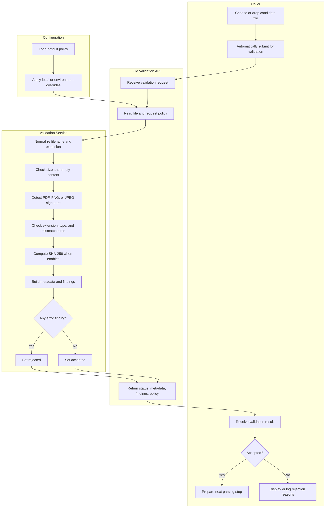

<!-- M3 - File Validation Module Start -->
<!-- Provides the swimlane activity flow for the standalone File Validation Module. -->

# M3 File Validation Module Activity Flow

## Swimlane Activity Diagram

## Activity Summary

| Swimlane | Responsibility |
| --- | --- |
| Caller | Supplies the candidate file and consumes the accepted/rejected result. |
| File Validation API | Owns the HTTP boundary, upload parsing, policy construction, and response contract. |
| Configuration | Supplies safe runtime defaults and environment-specific overrides. |
| Validation Service | Performs reusable validation checks and produces metadata/findings. |

## Decision Outcomes

| Decision | Accepted Path | Rejected or Warning Path |
| --- | --- | --- |
| Empty file | Non-empty content continues. | `EMPTY_FILE` error. |
| File size | Size is within policy. | `FILE_TOO_LARGE` error. |
| Extension | Extension is allowed. | `MISSING_EXTENSION` or `UNSUPPORTED_EXTENSION` error. |
| Signature | Known PDF/PNG/JPEG signature when required. | `UNKNOWN_SIGNATURE` error. |
| Type policy | Detected MIME type is allowed. | `UNSUPPORTED_TYPE` error. |
| Extension/signature consistency | Extension matches detected content. | `SIGNATURE_EXTENSION_MISMATCH` error. |
| Browser content type | Matches detected content. | `CONTENT_TYPE_MISMATCH` warning. |

<!-- M3 End -->
