<!-- M5 - Document Parsing Module Start -->
<!-- Provides the swimlane activity flow for the merged Document Parsing and Classification Module. -->

# M5 Document Parsing Module Activity Flow

## Scope

This activity flow shows the merged M5 path from a validation-accepted document to an evaluation-ready parsing result. M5 owns PDF text extraction, Tesseract OCR fallback, image orientation handling, document classification, OCR/text quality metadata, ethical evidence redaction, and the JSON output consumed by Stats Web and M7.

M5 does not validate uploads, create ingestion records, extract final transaction rows, persist Stats records, or render dashboards.

## Swimlane Activity Diagram

```mermaid
flowchart TB
    classDef caller fill:#f4f7fb,stroke:#4d6a85,color:#102332
    classDef api fill:#e7f6f2,stroke:#318977,color:#102d28
    classDef config fill:#eef0ff,stroke:#6667ab,color:#202040
    classDef parser fill:#fff3df,stroke:#ad7420,color:#382300
    classDef ocr fill:#f8e8ef,stroke:#b85c84,color:#3b1024
    classDef classify fill:#edf7df,stroke:#6b9e2f,color:#23370d
    classDef output fill:#f7f7f7,stroke:#707070,color:#202020

    subgraph Caller["Caller / Stats Web"]
        direction TB
        A0(["Start"])
        A1["User drops or selects document"]
        A2["M3/M4 validates and ingests accepted file"]
        A3["Automatically call M5 parse endpoint"]
        A4["Receive parse summary and full JSON"]
        A5{"Parse usable for M7?"}
        A6["Send M5 result to M7"]
        A7["Show needs-review findings"]
        A8(["End"])
    end

    subgraph Api["M5 API Boundary"]
        direction TB
        B1["Receive multipart document and trace metadata"]
        B2["Detect MIME type from content and request"]
        B3{"Supported PDF, PNG, JPG, or JPEG?"}
        B4["Return unsupported result"]
        B5["Create parse attempt context"]
        B6["Return Document Parsing Result JSON"]
    end

    subgraph Config["Configuration"]
        direction TB
        C1["Load defaults.env"]
        C2["Apply local .env and environment overrides"]
        C3["Resolve OCR, page, size, classification, and redaction settings"]
    end

    subgraph Parser["Parsing Strategy Service"]
        direction TB
        D1{"PDF document?"}
        D2["Try direct embedded PDF text extraction"]
        D3{"Usable text found?"}
        D4["Use pdf_text strategy"]
        D5{"OCR fallback allowed?"}
        D6["Add OCR disabled finding"]
        D7{"Tesseract available?"}
        D8["Add Tesseract unavailable finding"]
        D9{"PDF renderer needed and available?"}
        D10["Render PDF pages for OCR"]
        D11["Open image content for OCR"]
    end

    subgraph Ocr["OCR Quality Loop"]
        direction TB
        E1["Apply EXIF orientation correction"]
        E2["Preprocess image: normalize, grayscale, contrast, upscale"]
        E3["Try configured orientations"]
        E4["Try configured Tesseract PSM values"]
        E5["Collect text and mean confidence"]
        E6["Score OCR attempt using confidence, text length, alphanumeric ratio, and financial keywords"]
        E7["Select best OCR attempt"]
        E8{"OCR quality acceptable?"}
        E9["Add LOW_OCR_CONFIDENCE or OCR_TEXT_NOISY finding"]
        E10["Record selected orientation, PSM, attempt count, and quality score"]
    end

    subgraph Classify["Classification and Evidence"]
        direction TB
        F1["Build page-level text and quality metadata"]
        F2["Classify document type"]
        F3{"Confidence above threshold?"}
        F4["Return classified document type"]
        F5["Return unknown classification finding"]
        F6["Redact personal information, account numbers, card numbers, and sensitive identifiers"]
        F7["Build evaluation metadata"]
    end

    subgraph Output["Output and Downstream Contract"]
        direction TB
        G1["Assemble parse_id, status, document trace, text, pages, metadata, strategy, classification, quality, evidence, findings"]
        G2{"Any error finding?"}
        G3["Set failed or unsupported status"]
        G4{"Any warning finding?"}
        G5["Set completed_with_warnings status"]
        G6["Set completed status"]
        G7["Expose JSON for UI, evidence, and M7 handoff"]
    end

    A0 --> A1 --> A2 --> A3 --> B1
    C1 --> C2 --> C3 --> B1
    B1 --> B2 --> B3
    B3 -- "No" --> B4 --> B6
    B3 -- "Yes" --> B5 --> D1
    D1 -- "Yes" --> D2 --> D3
    D3 -- "Yes" --> D4 --> F1
    D3 -- "No" --> D5
    D1 -- "No, image" --> D5
    D5 -- "No" --> D6 --> F1
    D5 -- "Yes" --> D7
    D7 -- "No" --> D8 --> F1
    D7 -- "Yes" --> D9
    D9 -- "PDF renderer unavailable" --> D8
    D9 -- "PDF renderer available" --> D10 --> E1
    D9 -- "Image input" --> D11 --> E1
    E1 --> E2 --> E3 --> E4 --> E5 --> E6 --> E7 --> E8
    E8 -- "No" --> E9 --> E10
    E8 -- "Yes" --> E10
    E10 --> F1
    F1 --> F2 --> F3
    F3 -- "Yes" --> F4 --> F6
    F3 -- "No" --> F5 --> F6
    F6 --> F7 --> G1 --> G2
    G2 -- "Yes" --> G3 --> G7
    G2 -- "No" --> G4
    G4 -- "Yes" --> G5 --> G7
    G4 -- "No" --> G6 --> G7
    G7 --> B6 --> A4 --> A5
    A5 -- "Yes" --> A6 --> A8
    A5 -- "No" --> A7 --> A8

    class A0,A1,A2,A3,A4,A5,A6,A7,A8 caller
    class B1,B2,B3,B4,B5,B6 api
    class C1,C2,C3 config
    class D1,D2,D3,D4,D5,D6,D7,D8,D9,D10,D11 parser
    class E1,E2,E3,E4,E5,E6,E7,E8,E9,E10 ocr
    class F1,F2,F3,F4,F5,F6,F7 classify
    class G1,G2,G3,G4,G5,G6,G7 output
```

## Activity Summary

| Swimlane | Responsibility |
| --- | --- |
| Caller / Stats Web | Starts the seamless validate, ingest, parse flow and displays the parse summary plus full M5 JSON. |
| M5 API Boundary | Owns the HTTP contract, trace metadata, MIME detection, supported-type decision, and parse response. |
| Configuration | Supplies OCR, page-limit, classification, redaction, and runtime settings from safe defaults and overrides. |
| Parsing Strategy Service | Chooses direct PDF text extraction, OCR fallback, disabled-OCR handling, or dependency failure handling. |
| OCR Quality Loop | Applies EXIF correction, image preprocessing, orientation retry, PSM retry, Tesseract execution, and OCR quality scoring. |
| Classification and Evidence | Classifies the parsed document, creates quality metadata, redacts sensitive evidence, and prepares evaluation fields. |
| Output and Downstream Contract | Builds the Document Parsing Result JSON for Stats Web evidence and M7 transaction extraction. |

## Decision Outcomes

| Decision | Successful Path | Warning or Failure Path |
| --- | --- | --- |
| Supported file type | PDF, PNG, JPG, or JPEG continues. | `UNSUPPORTED_MEDIA_TYPE`. |
| PDF embedded text | Usable text uses `pdf_text`. | No text moves to OCR fallback decision. |
| OCR fallback | Enabled OCR continues to dependency checks. | `OCR_FALLBACK_DISABLED`. |
| Tesseract availability | Available Tesseract runs OCR. | `TESSERACT_UNAVAILABLE`. |
| PDF rendering | Renderer converts scanned PDF pages to images. | `PDF_RENDERER_UNAVAILABLE`. |
| OCR quality | Best scored text is selected and metadata is recorded. | `LOW_OCR_CONFIDENCE` or `OCR_TEXT_NOISY`. |
| Classification confidence | Supported document type is returned. | `CLASSIFICATION_UNKNOWN`. |
| Sensitive evidence | Redacted preview and redaction counts are returned. | Raw sensitive values must not be copied into evidence summaries. |
| Final status | No warnings returns `completed`. | Warnings return `completed_with_warnings`; errors return `failed` or `unsupported`. |

## M7 Handoff Note

M5 sends extracted text, pages, classification, quality metadata, OCR metadata, redacted evidence, and findings downstream. M7 must consume those signals and report input-quality findings such as `UPSTREAM_OCR_QUALITY_WEAK` when M5 reports weak OCR. M7 must not rerun Tesseract.

<!-- M5/M6 End -->
