<!-- M9 - Stats Data and Persistence Start -->
<!-- Defines the draft ERD for M9 Stats Data and the current M1 users table. -->

# M9 Stats Data ERD

This ERD shows the planned Stats database shape for M9, including the current M1 Identity Access `users` table because M9 records must be scoped to authenticated users.

M1 owns user authentication fields. M9 references `users.id` for ownership, save actions, and review resolution, but M9 must not expose password hashes or token material through Stats Data APIs.

## Draft ERD

```mermaid
erDiagram
    USERS {
        string id PK
        string email UK
        string full_name
        string hashed_password
        string role
        boolean is_active
        boolean must_change_password
        datetime created_at
        datetime updated_at
        datetime last_login_at
    }

    VALIDATION_RESULTS {
        string validation_result_id PK
        string validation_id UK
        string extraction_id
        string parse_id
        string ingestion_id
        string uploaded_by_user_id FK
        string document_type
        string status
        string document_review_status
        string recommended_action
        int normalized_record_count
        int valid_record_count
        int warning_record_count
        int invalid_record_count
        int duplicate_record_count
        int review_item_count
        int section_candidate_count
        int entity_count
        int reference_count
        int line_item_count
        int installment_count
        int warning_installment_count
        int invalid_installment_count
        decimal debit_total
        decimal credit_total
        decimal net_total
        decimal reconciliation_delta
        json payload_json
        string promotion_status
        string promotion_error
        datetime created_at_utc
        datetime promoted_at_utc
    }

    STATS_DOCUMENTS {
        string document_id PK
        string ingestion_id
        string uploaded_by_user_id FK
        string validation_result_id FK
        string original_filename
        string normalized_filename
        string source_type
        string source_id
        string sha256
        string detected_mime_type
        int size_bytes
        string storage_reference
        string document_type
        string source_institution
        string status
        string ocr_quality_status
        boolean redaction_applied
        datetime created_at_utc
        datetime updated_at_utc
    }

    PROCESSING_RUNS {
        string processing_run_id PK
        string document_id FK
        string parse_id
        string extraction_id
        string validation_id
        string module_name
        string module_version
        string status
        datetime started_at_utc
        datetime completed_at_utc
        json summary_json
        json finding_counts_json
    }

    TRANSACTION_BATCHES {
        string transaction_batch_id PK
        string document_id FK
        string validation_id
        string saved_by_user_id FK
        string status
        int input_record_count
        int saved_record_count
        int duplicate_record_count
        int warning_record_count
        int invalid_record_count
        decimal debit_total
        decimal credit_total
        decimal net_total
        datetime created_at_utc
    }

    TRANSACTIONS {
        string transaction_id PK
        string transaction_batch_id FK
        string document_id FK
        string source_candidate_id
        date transaction_date
        date posted_date
        string description
        string normalized_description
        decimal amount
        string currency
        string direction
        decimal signed_amount
        string source_institution
        string merchant_or_counterparty
        string category
        string reference
        string payment_method
        string masked_account_or_card
        decimal confidence
        string quality_status
        boolean review_required
        string duplicate_of_transaction_id FK
        string duplicate_key
        int source_page_number
        int source_line_number
        string source_section_id
        string source_section_label
        string source_text_redacted
        decimal source_ocr_confidence
        decimal source_extraction_confidence
        json reason_codes_json
        datetime created_at_utc
        datetime updated_at_utc
    }

    FINANCIAL_FIELDS {
        string financial_field_id PK
        string document_id FK
        string transaction_batch_id FK
        string field_name
        string field_label
        string value_type
        string value
        string currency
        decimal confidence
        string quality_status
        int source_page_number
        int source_line_number
        string source_section_id
        string source_section_label
        string source_text_redacted
        decimal source_ocr_confidence
        decimal source_extraction_confidence
        json reason_codes_json
    }

    DOCUMENT_SECTIONS {
        string document_section_id PK
        string document_id FK
        string source_section_id
        string section_label
        int page_number
        int first_line_number
        int last_line_number
        string source_text_redacted
        decimal confidence
        json reason_codes_json
        datetime created_at_utc
    }

    STATEMENT_SUMMARIES {
        string statement_summary_id PK
        string document_id FK
        date statement_date
        date period_start_date
        date period_end_date
        date payment_due_date
        decimal minimum_amount_due
        decimal total_amount_due
        decimal previous_balance
        decimal payments_total
        decimal purchases_total
        decimal fees_total
        decimal interest_total
        decimal installment_balance
        decimal outstanding_balance
        decimal credit_limit
        decimal available_credit
        string currency
        decimal confidence
        string quality_status
    }

    DOCUMENT_FINANCIAL_SUMMARIES {
        string document_financial_summary_id PK
        string document_id FK
        string invoice_number
        date issue_date
        decimal subtotal_amount
        decimal tax_amount
        decimal total_amount
        decimal paid_amount
        decimal owing_amount
        string currency
        string payment_status
        decimal confidence
        string quality_status
    }

    LINE_ITEMS {
        string line_item_id PK
        string document_id FK
        string source_line_item_id
        string description
        decimal amount
        string currency
        decimal quantity
        decimal unit_amount
        decimal line_amount
        decimal tax_amount
        string category
        decimal confidence
        string quality_status
        int source_page_number
        int source_line_number
        string source_section_id
        string source_section_label
        string source_text_redacted
        decimal source_ocr_confidence
        decimal source_extraction_confidence
        json reason_codes_json
    }

    VALIDATED_ENTITIES {
        string validated_entity_id PK
        string document_id FK
        string source_entity_id
        string entity_type
        string value
        decimal confidence
        string quality_status
        int source_page_number
        int source_line_number
        string source_section_id
        string source_section_label
        string source_text_redacted
        decimal source_ocr_confidence
        decimal source_extraction_confidence
        json reason_codes_json
    }

    VALIDATED_REFERENCES {
        string validated_reference_id PK
        string document_id FK
        string source_reference_id
        string reference_type
        string value
        boolean masked
        decimal confidence
        string quality_status
        int source_page_number
        int source_line_number
        string source_section_id
        string source_section_label
        string source_text_redacted
        decimal source_ocr_confidence
        decimal source_extraction_confidence
        json reason_codes_json
    }

    INSTALLMENTS {
        string installment_id PK
        string document_id FK
        string source_installment_id
        date purchase_date
        date posted_date
        string description
        decimal principal_amount
        decimal current_billing_amount
        decimal remaining_balance
        string currency
        string term_text
        decimal confidence
        string quality_status
        int source_page_number
        int source_line_number
        string source_section_id
        string source_section_label
        string source_text_redacted
        decimal source_ocr_confidence
        decimal source_extraction_confidence
        json reason_codes_json
        datetime created_at_utc
        datetime updated_at_utc
    }

    FINANCIAL_EVIDENCE_LINKS {
        string financial_evidence_link_id PK
        string source_document_id FK
        string target_document_id FK
        string source_transaction_id FK
        string target_transaction_id FK
        string link_type
        string match_status
        decimal match_confidence
        string match_reason
        string reference
        datetime created_at_utc
        datetime updated_at_utc
    }

    FINDINGS {
        string finding_id PK
        string document_id FK
        string transaction_id FK
        string processing_run_id FK
        string source_module
        string code
        string severity
        string message
        string status
        datetime created_at_utc
        datetime resolved_at_utc
        string resolved_by_user_id FK
    }

    REVIEW_ITEMS {
        string review_item_id PK
        string document_id FK
        string transaction_id FK
        string source_review_id
        string item_type
        string severity
        string title
        string message
        string record_id
        string field_name
        string recommended_action
        string status
        int source_page_number
        int source_line_number
        string source_section_id
        string source_section_label
        string source_text_redacted
        decimal source_ocr_confidence
        decimal source_extraction_confidence
        json reason_codes_json
        datetime created_at_utc
        datetime resolved_at_utc
        string resolved_by_user_id FK
    }

    USERS ||--o{ VALIDATION_RESULTS : uploads
    USERS ||--o{ STATS_DOCUMENTS : owns
    USERS ||--o{ TRANSACTION_BATCHES : saves
    USERS ||--o{ FINDINGS : resolves
    USERS ||--o{ REVIEW_ITEMS : resolves

    VALIDATION_RESULTS ||--o{ STATS_DOCUMENTS : promotes_to
    STATS_DOCUMENTS ||--o{ PROCESSING_RUNS : has
    STATS_DOCUMENTS ||--o{ TRANSACTION_BATCHES : has
    STATS_DOCUMENTS ||--o{ TRANSACTIONS : sources
    TRANSACTION_BATCHES ||--o{ TRANSACTIONS : contains

    STATS_DOCUMENTS ||--o{ FINANCIAL_FIELDS : has
    TRANSACTION_BATCHES ||--o{ FINANCIAL_FIELDS : captures
    STATS_DOCUMENTS ||--o{ DOCUMENT_SECTIONS : has
    STATS_DOCUMENTS ||--o{ STATEMENT_SUMMARIES : has
    STATS_DOCUMENTS ||--o{ DOCUMENT_FINANCIAL_SUMMARIES : has
    STATS_DOCUMENTS ||--o{ LINE_ITEMS : has
    STATS_DOCUMENTS ||--o{ VALIDATED_ENTITIES : has
    STATS_DOCUMENTS ||--o{ VALIDATED_REFERENCES : has
    STATS_DOCUMENTS ||--o{ INSTALLMENTS : has

    STATS_DOCUMENTS ||--o{ FINDINGS : has
    TRANSACTIONS ||--o{ FINDINGS : has
    PROCESSING_RUNS ||--o{ FINDINGS : emits
    STATS_DOCUMENTS ||--o{ REVIEW_ITEMS : has
    TRANSACTIONS ||--o{ REVIEW_ITEMS : has

    TRANSACTIONS ||--o| TRANSACTIONS : duplicates
    STATS_DOCUMENTS ||--o{ FINANCIAL_EVIDENCE_LINKS : source_document
    STATS_DOCUMENTS ||--o{ FINANCIAL_EVIDENCE_LINKS : target_document
    TRANSACTIONS ||--o{ FINANCIAL_EVIDENCE_LINKS : source_transaction
    TRANSACTIONS ||--o{ FINANCIAL_EVIDENCE_LINKS : target_transaction
```

## Notes

- `users` is the current M1 table from `modules/identity-access-module/app/models/user.py`.
- `hashed_password` is shown only because it exists in the M1 database component. M9 query APIs must not expose it.
- `validation_results.payload_json` is the staging/audit copy of the exact validation result.
- Dashboard queries should use promoted relational tables, not the staging JSON payload.
- M9 persists only validation output. M5 parse IDs and M7 extraction IDs are lineage fields; raw M5/M7 metadata is not promoted into first-class reporting tables.
- `document_sections`, `validated_entities`, `validated_references`, `line_items`, and `installments` reflect the enriched validation handoff used for robust dashboard and review experiences.
- `findings` are module/system findings. `review_items` are user-facing review tasks derived from Data Validation review items or M9 duplicate/reconciliation checks.
- `financial_evidence_links` is intentionally flexible so M9 can relate invoice-to-proof, receipt-to-EFTPOS, statement-to-transaction, and duplicate-like evidence without forcing everything into `transactions`.

<!-- M9 End -->
