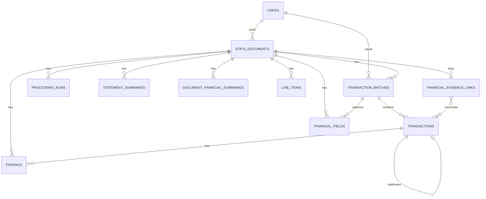

<!-- M9 - Stats Data and Persistence Start -->
<!-- Plans the Stats-owned database schema, persistence boundaries, and stored data model. -->

# Module 9 Stats Data and Persistence Module Specification

## Module Summary

Module 9 establishes the Stats-owned database and persistence layer.

M9 stores product data produced by the reusable processing modules: document intake metadata, processing run summaries, normalized transaction records, validation results, duplicate-check outcomes, and user ownership links. It is also the durable source of data for the future Stats dashboard and reporting modules. It does not perform OCR, extraction, validation, dashboard rendering, or identity authentication.

Earlier modules may still be incomplete while this spec is refined. The purpose of this draft is to define what the database must eventually remember so upstream modules can keep their contracts stable and M10/M11 can build on reliable stored records.

## Architecture Alignment

| Field | M9 Direction |
| --- | --- |
| Build order | `9` |
| Module | Stats Data and Persistence |
| Type | Encompassing product module |
| Main responsibility | Database schema, migrations, persistence adapters, duplicate checks against stored records, retrieval APIs |
| Owner folder | `apps/stats-data/` |
| Primary input | Data Validation `DataValidationResult` plus authenticated user context |
| Primary output | Saved document/workflow/transaction records and queryable data for review, dashboarding, and reporting |

## Goals

- Define the Stats product database schema separately from reusable processing modules.
- Store Data Validation normalized records only after the user chooses to save ready transactions.
- Preserve traceability from saved transactions back to validation, extraction, parse, and ingestion identifiers.
- Support database-backed duplicate checks before insert.
- Track long-running upload processing jobs so cloud uploads do not depend on one browser request staying open while OCR/parsing/extraction/validation completes.
- Persist per-step upload timing records so Docker/cloud logs and Azure SQL agree on how long validation, ingestion, parsing, extraction, validation, duplicate-check, and save stages took for a document.
- Associate stored documents and transactions with the authenticated user who uploaded or saved them.
- Keep sensitive financial document data controlled and avoid persisting full OCR text unless explicitly justified later.
- Provide migrations and persistence adapters under `apps/stats-data/`.
- Keep runtime database configuration environment-driven and compatible with Azure SQL Database as the cloud operational store.
- Shape stored transaction and document data so later dashboard/reporting modules can query totals, trends, status counts, categories, sources, and review backlogs without rereading source files or rerunning processing modules.
- Preserve document-level financial facts for M11 to answer obligations, payments, reconciliation, credit exposure, and evidence-quality questions.
- Treat Upload transaction review/accept/save as a human-confirmation path for AI-suggested transaction and spending labels, activating accepted new labels/subtypes during save with audit metadata.
- Learn reusable merchant classifications from human-confirmed saved transactions so repeated merchants can be classified without repeated AI calls or user review.
- Expose an internal learned merchant classification lookup for M7 that returns only safe, active, non-conflicted exact normalized merchant matches during the MVP.

## Non-Goals

- Reimplementing M1 identity, password, token, or role logic.
- Reimplementing M3/M4 file validation or file storage behavior.
- Reimplementing M5 parsing, M7 extraction, or validation rules.
- Rendering dashboards or report visualizations.
- Owning final dashboard UX, chart layout, or visual analytics decisions.
- Email mailbox polling or attachment retrieval.
- Production cloud database deployment.

## Data To Store

### Learned Merchant Classification Profiles

M9 owns the durable learning layer for reusable merchant classifications. M7 may consume this layer, but M7 must not persist learned profiles itself.

MVP learning rules:

- Learn only from transactions saved through a user-reviewed or user-accepted workflow where `classification_human_confirmed = true`.
- Learn only when `transaction_subtype` and `spending_subcategory` are present, active, and not `unknown`.
- Derive `transaction_type` and `spending_category` from active parent-child mappings where possible; reject or review-gate saves where child and parent classifications conflict.
- Reuse only exact normalized merchant matches for MVP. Fuzzy matching is explicitly deferred.
- Do not learn from unreviewed AI output, failed saves, skipped duplicate rows, invalid rows, or post-MVP automated/email ingestion rows that have not been human-confirmed.

Recommended table: `merchant_classification_profiles`

| Field | Purpose |
| --- | --- |
| `merchant_profile_id` | Stable profile identifier. |
| `merchant_key` | Normalized merchant/counterparty key used for exact matching. |
| `merchant_display_name` | Human-readable merchant name from the latest or best confirmed transaction. |
| `transaction_type` | Active parent movement type derived from subtype. |
| `transaction_subtype` | Learned movement child label. |
| `spending_category` | Active parent reporting category derived from subcategory. |
| `spending_subcategory` | Learned reporting child label. |
| `classification_source` | `human_confirmed_transaction`. |
| `confirmation_count` | Number of matching human-confirmed saves supporting this profile. |
| `conflict_count` | Number of later human-confirmed saves that disagreed with the current profile. |
| `profile_status` | `active`, `conflicted`, `inactive`, or `retired`. |
| `first_confirmed_transaction_id` | First saved transaction that taught the profile. |
| `last_confirmed_transaction_id` | Most recent supporting saved transaction. |
| `last_confirmed_by_user_id` | User who last confirmed the active profile. |
| `last_confirmed_at_utc` | Timestamp of last supporting confirmation. |
| `created_at_utc`, `updated_at_utc` | Profile lifecycle timestamps. |

Recommended indexes:

- Unique index on `merchant_key` for active exact-match lookup.
- Index on `profile_status`, `merchant_key`.
- Index on `last_confirmed_at_utc` for audit/review.

Save-time upsert behavior:

1. M9 computes the same normalized merchant key used by M7 lookup.
2. If no profile exists and the saved transaction is human-confirmed with complete active classifications, M9 inserts an active profile.
3. If an active profile exists with the same transaction/spending child values, M9 increments `confirmation_count` and updates the last-confirmed metadata.
4. If an active profile exists with different transaction or spending child values, M9 marks the profile `conflicted`, increments `conflict_count`, and does not let future M7 calls auto-apply it until a future admin or user-management workflow resolves the conflict.
5. If active vocabulary changes later deactivate, rename, or merge a profile's labels, M9 must either synchronize the profile through the same controlled label-sync path or mark it inactive/conflicted so M7 cannot auto-apply stale labels.

Internal lookup behavior for M7:

```text
GET /api/v1/internal/merchant-classifications/lookup
```

The lookup accepts a transaction description and optional merchant/counterparty evidence, document type/subtype, direction, and source context. It returns:

- normalized `merchant_key`
- match status: `matched`, `not_found`, `conflicted`, `inactive`, or `unsafe`
- match type: `exact_normalized_merchant` for MVP
- learned transaction type/subtype and spending category/subcategory when safe
- profile confidence derived from confirmation count and conflict state
- reason codes such as `PRIOR_MERCHANT_CLASSIFICATION_REUSED`, `PRIOR_MERCHANT_CLASSIFICATION_CONFLICT`, or `PRIOR_MERCHANT_CLASSIFICATION_INACTIVE`

The lookup must not expose unrelated users' transaction details, raw OCR text, secrets, or full source documents. The MVP may share learned merchant profiles across users only if the project explicitly chooses global learning; otherwise profiles must be scoped by user or tenant. Until that decision is made, the implementation should prefer user-scoped profiles or include an explicit `profile_scope` field.

Deferred fuzzy matching:

- Fuzzy matching must not be part of the MVP exact-match implementation.
- Later fuzzy matching should run only after exact lookup fails.
- It must require a high similarity threshold, avoid short/generic merchant names, detect ambiguous close matches, and route ambiguous or low-confidence matches to review.
- Fuzzy-applied rows must use a separate classification source such as `prior_merchant_fuzzy_human_confirmed`.

### Identity-Owned Data

M1 already owns identity account behavior. M9 may reference identity users by stable user ID, but it must not expose or duplicate password hashes, token material, first-login state, or identity internals.

Current identity table data remains behind the identity module contract:

| Data | Owner | M9 Use |
| --- | --- | --- |
| User ID | M1 | Foreign/reference key for ownership and audit fields |
| Email/full name/role | M1 | Display through identity API when needed |
| Password hash/token fields | M1 | Not used by M9 |

### Validation Result Staging

M9 should keep a staging/audit table for each Data Validation `DataValidationResult` received from Stats Web before records are promoted into dashboard-ready relational tables.

This staging table is recommended because validation output includes nested arrays, evolving contract fields, review metadata, source references, and summary/evaluation data. Staging preserves the exact module result for troubleshooting, reprocessing, and contract-change safety while the normalized tables serve dashboard and reporting queries.

Before the database write, M9 should write the received validation payload to a temporary handoff JSON file under the centrally managed `STATS_VALIDATION_HANDOFF_DIR` path, which defaults to `apps/stats-data/data/validation-handoff` through `config/stats.runtime.json` and `config/stats.paths.json`. M9 must persist from that exact file, then remove the temporary file only after the Azure SQL transaction commits and `validation_results.promotion_status` is marked `promoted`. If the save fails, the temporary file should remain available for retry and troubleshooting. After a successful commit, handoff cleanup is best-effort: cleanup errors are logged but must not turn a committed save into an API failure. Data Validation still does not own durable file storage; this temporary file is part of the M9 save boundary.

Validation persistence is retry-safe. Re-submitting the same validation payload must not reset a previously promoted `validation_results` row back to pending, must not clear `promotion_error` or `promoted_at_utc`, and must not replace an existing non-empty `stats_documents.storage_reference` with an empty value.

Recommended table:

| Table | Purpose |
| --- | --- |
| `validation_results` | Exact validation result envelope plus high-value indexed columns |

Important fields:

| Field | Purpose |
| --- | --- |
| `validation_result_id` | Stats-owned staging row identifier |
| `validation_id` | validation identifier, unique when present |
| `extraction_id` | M7 extraction identifier |
| `parse_id` | M5 parse identifier |
| `ingestion_id` | M3/M4 ingestion identifier from `document` |
| `uploaded_by_user_id` | User scope for the result |
| `document_type` | Data Validation document type |
| `status` | validation status |
| `document_review_status` | validation summary review status |
| `recommended_action` | validation summary recommended action |
| `normalized_record_count` | validation summary count |
| `valid_record_count` | validation summary count |
| `warning_record_count` | validation summary count |
| `invalid_record_count` | validation summary count |
| `duplicate_record_count` | validation summary count |
| `review_item_count` | validation summary count |
| `section_candidate_count` | validation summary count for source/document sections |
| `entity_count` | validation summary count for validated entities |
| `reference_count` | validation summary count for validated references |
| `line_item_count` | validation summary count for validated line items |
| `installment_count` | validation summary count for normalized installment obligations |
| `warning_installment_count` | validation summary count for installments needing review |
| `invalid_installment_count` | validation summary count for blocked installment records |
| `debit_total` | validation summary debit total |
| `credit_total` | validation summary credit total |
| `net_total` | validation summary net total |
| `reconciliation_delta` | validation summary reconciliation difference |
| `payload_json` | Full Data Validation `DataValidationResult` JSON |
| `promotion_status` | Pending, promoted, partially promoted, rejected, failed |
| `promotion_error` | Controlled error details when promotion fails |
| `created_at_utc` | Staging insert time |
| `promoted_at_utc` | Promotion completion time |

M9 should not use this staging table as the main dashboard source. Dashboard/reporting queries should read from promoted tables such as `transactions`, `document_financial_summaries`, `line_items`, `findings`, and `financial_evidence_links`.

### Document Intake And Workflow Data

M9 should store a product-level document/workflow record for each file that reaches the save/review stage.

| Field | Purpose |
| --- | --- |
| `document_id` | Stats-owned stable document identifier |
| `ingestion_id` | Link to M3/M4 ingestion result |
| `uploaded_by_user_id` | User who submitted or owns the document |
| `original_filename` | User-recognizable source filename |
| `normalized_filename` | Stored/sanitized filename |
| `source_type` | Manual upload, email attachment, batch import, API |
| `source_id` | Optional upstream source identifier |
| `sha256` | File hash for duplicate/source matching |
| `document_fingerprint` | Hashed normalized document-level evidence for same-document matching across renamed files or different photos |
| `detected_mime_type` | Accepted content type |
| `size_bytes` | File size |
| `storage_reference` | Local/cloud path or object key, not raw file bytes |
| `document_type` | upstream document classification label |
| `source_institution` | Bank, merchant, provider, biller, or counterparty when known |
| `status` | Current workflow status |
| `ocr_quality_status` | Good, partial, low, failed, or not applicable |
| `redaction_applied` | Whether sensitive snippets were masked before storage/display |
| `created_at_utc` | Record creation time |
| `updated_at_utc` | Last update time |

Recommended statuses:

- `uploaded`
- `parsed`
- `extracted`
- `validated`
- `ready_to_save`
- `saved`
- `needs_review`
- `failed`

### Processing Run Data

M9 should store lightweight run metadata for traceability and evidence without storing full sensitive OCR text.

| Field | Purpose |
| --- | --- |
| `processing_run_id` | Stats-owned run identifier |
| `document_id` | Parent document |
| `parse_id` | M5 parse identifier |
| `extraction_id` | M7 extraction identifier |
| `validation_id` | validation identifier |
| `module_name` | Parsing, extraction, validation, persistence |
| `module_version` | Version when available |
| `status` | Completed, completed with warnings, failed |
| `started_at_utc` | Run start |
| `completed_at_utc` | Run completion |
| `summary_json` | Counts/totals/evaluation summary |
| `finding_counts_json` | Aggregated finding counts |

M9 should avoid storing full unredacted OCR text in this table. If later review workflows require source snippets, store redacted snippets or source references only.

### Validation Batch Data

M9 should store the validation save attempt as a batch so the UI can show what was accepted, skipped, or needs review.

| Field | Purpose |
| --- | --- |
| `transaction_batch_id` | Save attempt identifier |
| `document_id` | Parent document |
| `validation_id` | validation identifier |
| `saved_by_user_id` | User who confirmed saving |
| `status` | Saved, partially saved, rejected, needs review |
| `input_record_count` | Normalized records received |
| `saved_record_count` | Records inserted |
| `duplicate_record_count` | Records skipped as duplicates |
| `warning_record_count` | Records saved or held with warnings |
| `invalid_record_count` | Records rejected |
| `debit_total` | Batch debit total |
| `credit_total` | Batch credit total |
| `net_total` | Batch net total |
| `created_at_utc` | Save attempt time |

### Pre-Save Duplicate Checks

M9 must perform database-backed duplicate checks before Stats Web saves reviewed transactions. This is separate from M8 request-local duplicate detection. M8 can flag duplicate rows inside one validation payload, but only M9 can compare against persisted documents and transactions.

Stats Web should call a M9 duplicate-check endpoint after M8 validation and local review edits, but before `POST /api/v1/transactions/batches`.

Recommended endpoint:

```text
POST /api/v1/transactions/duplicate-checks
```

The request should include the current Data Validation result, user scope, and optional storage reference. The response should include a persisted `duplicate_check_id`, document-level matches, per-record transaction matches, and summary counts.

When this endpoint returns `blocked` or `needs_review`, Stats Web must not present the result as a generic database save failure. The upload page should show a plain-language duplicate review panel with the duplicate-check status, summary counts, and the document/transaction messages returned by M9, such as whether the same file was already uploaded, the document fingerprint looks similar, a transaction already exists, or a row has the same date/amount/currency/direction as a saved transaction.

Duplicate match types:

| Match Type | Meaning |
| --- | --- |
| `exact_file_duplicate` | `stats_documents.sha256` already exists for the user |
| `possible_same_document` | Document fingerprint evidence matches a previously saved document |
| `within_batch_duplicate` | Two rows in the current validation payload share the same duplicate key |
| `exact_transaction_duplicate` | A saved transaction has the same duplicate key |
| `possible_transaction_duplicate` | Date, amount, currency, and direction match, but description differs |

M9 should persist duplicate-check batches and results so the review decision is auditable and tied back to database records. Exact transaction duplicates should be treated as blocking or skipped by the save workflow unless a future explicit override is added. Possible matches should require review but not be silently discarded.

Duplicate checks must treat empty duplicate keys and empty document fingerprints as unavailable evidence, not as real match keys. A row without a deterministic duplicate key may still be compared through possible-match signals such as date, amount, currency, and direction, but it must not collapse with other no-key rows as an exact duplicate. Persisted duplicate-check result identifiers must be stable from row content, match type, and matched database records rather than list position so a re-check cannot silently attach an old result row to a different transaction after ordering changes.

Exact transaction duplicate lookup should be batched by deterministic duplicate key when possible. Possible transaction matches are allowed to remain row-scoped until the matching model is mature enough to batch without broadening false-positive behavior across nullable dates, currencies, directions, or edited descriptions.

Document fingerprints are normalized evidence hashes used when filenames or image bytes differ. The first generic fingerprint should use available evidence from the validation payload: document type, source institution or merchant entity, document SHA-256, statement/invoice/receipt totals and dates, references, confirmation/approval/RRN values, masked account/card evidence, and a small set of normalized transaction keys when document-level evidence is sparse. The fingerprint must be stored as a hash, not as full unredacted source text.

## Long-Running Upload Processing Jobs

Cloud-dev proved that synchronous browser calls to M5 can exceed the Azure Container Apps ingress request timeout for OCR-heavy files. M9 therefore owns a durable processing-job checkpoint that Stats Web can create before starting module work and poll while work continues in the runtime container.

This job tracking does not move OCR, extraction, or validation logic into M9. M9 only records job state, progress, user ownership, safe document metadata, final validation payload, and sanitized error details.

Recommended table: `document_processing_jobs`

| Column | Purpose |
| --- | --- |
| `job_id` | Stable processing job identifier returned to Stats Web. |
| `ingestion_id` | M3/M4 ingestion identifier when available. |
| `uploaded_by_user_id` | User that started the upload workflow. |
| `original_filename` | Source filename for user-facing progress and troubleshooting. |
| `source_type` | Manual upload, email attachment, batch import, or API. |
| `source_id` | Source channel identifier. |
| `sha256` | File hash from validation metadata when available. |
| `status` | `queued`, `running`, `completed`, or `failed`. |
| `stage` | `uploaded`, `parsing`, `extracting`, `validating`, `completed`, or `failed`. |
| `message` | Short user-facing progress or failure message. |
| `parse_id` | M5 parse identifier after parsing completes. |
| `extraction_id` | M7 extraction identifier after extraction completes. |
| `validation_id` | M8 validation identifier after validation completes. |
| `result_payload_json` | Final validation/checkpoint payload for Stats Web review. |
| `error_detail` | Sanitized failure detail. |
| `created_at_utc`, `updated_at_utc`, `completed_at_utc` | Job lifecycle timestamps. |

API contract:

```text
POST /api/v1/processing-jobs
PATCH /api/v1/processing-jobs/{job_id}
GET /api/v1/processing-jobs/{job_id}
```

Recommended timing table: `document_processing_steps`

| Column | Purpose |
| --- | --- |
| `step_id` | Stable processing-step identifier. |
| `job_id` | Parent `document_processing_jobs.job_id`. |
| `document_id` | M9 document ID when known, otherwise null until persistence/save creates it. |
| `correlation_id` | Web/request correlation ID when available. |
| `module_name` | Module or boundary name, such as `StatsWeb`, `M3M4`, `M5`, `M7`, `M8`, or `M9`. |
| `step_name` | Stable step name, such as `file_validation`, `document_upload`, `document_parsing`, `transaction_extraction`, `data_validation`, `duplicate_check`, or `database_save`. |
| `status` | `started`, `completed`, `completed_with_warnings`, `failed`, or `skipped`. |
| `started_at_utc` | Step start time. |
| `completed_at_utc` | Step completion time when known. |
| `duration_ms` | Measured elapsed time in milliseconds. |
| `metadata_json` | Safe counts and identifiers, not raw OCR text or secret values. |
| `error_code` | Controlled failure code when the step fails. |
| `error_message` | Sanitized failure message when the step fails. |
| `created_at_utc` | Row insert time. |

Processing-step records are summaries, not a raw log sink. Detailed runtime diagnostics remain in structured application logs. M9 exposes `POST /api/v1/processing-jobs/{job_id}/steps` for appending step records and `GET /api/v1/processing-jobs/{job_id}/steps` for troubleshooting and future review UI. Stats Web must write a step record even when a step fails so cloud-dev operators can diagnose where an upload stalled. Timing writes attached to successful duplicate-check and transaction-save operations are best-effort after the primary work succeeds; a timing insert failure must be logged and must not change the successful primary API response into a 500.

Processing-job writes must clean up cursors on database errors. Once a job reaches a terminal status such as `completed` or `failed`, later updates must not move it back to a non-terminal status or overwrite its final stage/message accidentally. If Stats Web cannot write the initial upload timing step before launching the background processing task, it must delete the temporary upload file and fail the start request instead of orphaning local temp content.

Stats Web should:

- create the job immediately after M3/M4 accepts/queues the upload,
- run M5 -> M7 -> M8 outside the original browser request,
- avoid forcing `page_limit=1` on the background M5 request because the async job is intended to preserve complete statement coverage while avoiding ingress timeouts,
- update the job at each stage,
- poll the job from the Upload page,
- render the normal M8 transaction-check result once the job is `completed`,
- show a fresh upload picker and a concise failure message when the job is `failed`.

This is the first cloud-safe async workflow. It is compatible with current single-container cloud-dev. Future Blob Storage work should replace local temporary file handling so jobs can resume across container restarts.

### Transaction Records

This is the core durable financial data M9 should store from Data Validation normalized records. These records should be dashboard-ready enough to support totals, trends, category summaries, debit/credit splits, source-document drilldowns, and review counts without requiring dashboard code to parse raw module JSON.

| Field | Purpose |
| --- | --- |
| `transaction_id` | Stats-owned stable transaction identifier |
| `transaction_batch_id` | Save batch |
| `document_id` | Source document |
| `source_candidate_id` | upstream candidate link |
| `transaction_date` | Normalized transaction date |
| `posted_date` | Optional posted/settled date when statements provide both dates |
| `description` | Cleaned transaction description |
| `amount` | Positive absolute amount |
| `currency` | Currency code, default currently `PHP` |
| `direction` | Debit, credit, or unknown |
| `signed_amount` | Debit/credit signed value for reporting |
| `source_institution` | Bank, merchant, provider, or counterparty source |
| `merchant_or_counterparty` | Optional later normalized merchant/payee |
| `transaction_type` | Derived parent movement type for reporting, such as purchase, payment, transfer, refund, fee, interest, installment, adjustment, tax, or unknown |
| `transaction_subtype` | Required controlled movement child choice, such as card purchase, EFTPOS payment, bank transfer, credit-card payment, finance charge, late-payment fee, statement credit, or reversal |
| `spending_category` | Derived parent MVP reporting category, such as medical, pharmacy, groceries, utilities, transport, banking fees, interest, transfers, shopping, food/dining, income, tax, or uncategorized |
| `spending_subcategory` | Required controlled spending child choice |
| `category` | Backward-compatible or user-facing category alias; should converge with `spending_category` unless a user override model separates suggested and confirmed values |
| `classification_source` | `rules`, `ai`, `rules_ai_merged`, `user_override`, or `unknown` |
| `transaction_type_confidence` | Confidence for transaction type/subtype classification |
| `spending_category_confidence` | Confidence for spending category/subcategory classification |
| `classification_review_required` | Boolean flag when transaction/category classification is unknown, ambiguous, low-confidence, AI-assisted, or user-review-needed |
| `classification_human_confirmed` | Boolean flag that the saved transaction classification was reviewed and accepted by a user before persistence |
| `classification_confirmed_by_user_id` | User who confirmed the transaction/spending classification during save, when applicable |
| `classification_confirmed_at_utc` | Timestamp of save-time classification confirmation |
| `classification_confirmation_source` | Confirmation path such as `upload_transaction_review`, `admin_classification_review`, or `none` |
| `reference` | Optional transaction/reference code |
| `payment_method` | Card, bank transfer, EFTPOS, cash, unknown |
| `masked_account_or_card` | Masked account/card reference only |
| `confidence` | validation record confidence |
| `quality_status` | Valid, warning, invalid, duplicate |
| `review_required` | Boolean flag for dashboard/review queues |
| `duplicate_of_transaction_id` | Link when database duplicate is detected |
| `source_page_number` | Optional source page |
| `source_line_number` | Optional source line |
| `source_text_redacted` | Optional short redacted source snippet |
| `created_at_utc` | Insert time |
| `updated_at_utc` | Last update time |

Dashboard-facing query dimensions:

- Transaction date by day, month, quarter, and year.
- Direction: debit, credit, unknown.
- Currency.
- Transaction type and subtype.
- Spending category and subcategory.
- Classification source and classification confidence.
- Merchant or counterparty.
- Source institution.
- Payment method.
- Masked account/card where available.
- Source type and document type.
- Quality status and review state.
- Uploaded/saved user scope.

<!-- M9 Recognition Settings Persistence Start - 2026-06-10 -->
### Recognition Label Suggestions And Synchronization

M9 owns durable storage and synchronization for recognition-label governance. The database is the approved source of truth for allowed document labels, transaction labels, spending labels, deterministic rule signals, pending suggestions, approval history, audit records, and affected-record synchronization.

Committed recognition JSON files are deprecated for runtime use. They may be retained temporarily only as migration seed/reference material until equivalent M9 seed data exists. M5 and M7 must read active approved settings from M9. If M9 recognition settings are unavailable, M5/M7 must fail the classification portion clearly rather than silently using stale JSON files from the container image.

M9 must expose a compact active-recognition context for classifiers before any AI-assisted request is made. That context should include approved document types/subtypes, transaction subtype-to-type mappings, spending subcategory-to-category mappings, enabled aliases/rules, deprecation hints, merge hints, and stable vocabulary identifiers. M5 and M7 use this context to constrain AI prompts so existing active labels are preferred and proposed new labels are explicitly distinguishable from approved labels.

For MVP Upload review, M9 is the source of truth for controlled classification choices:

- Stats Web should display only active `transaction_subtype` and `spending_subcategory` choices, plus any M7/M8 supplied user-confirmable proposed child values for the current row.
- `transaction_type` and `spending_category` are derived from the selected child values and remain persisted/reporting fields.
- Save requests must validate that every child value maps to exactly one parent, or carry reviewed outside-vocabulary metadata that allows M9 to activate the child under an accepted parent during save.
- If a payload supplies a parent that conflicts with the selected child mapping, M9 must derive the parent from the child mapping or reject/review-gate the save when the conflict cannot be resolved safely.
- New human-confirmed child values activated during Upload save must be stored with their parent relationship so the next active-recognition context exposes them as controlled dropdown options.

The accepted governance flows are:

1. Any upload user may trigger a label suggestion through M5 or M7 when a document, transaction type, transaction subtype, spending category, or spending subcategory is unknown, ambiguous, or plausibly new.
2. M5/M7 do not write active settings directly. They return classification fields and review metadata with redacted evidence, source identifiers, proposed label values, confidence, reason codes, and suggested action.
3. When an AI-suggested transaction type, transaction subtype, spending category, or spending subcategory is reviewed and accepted in the Upload transaction review flow, M9 treats the save request as the human confirmation event for that transaction.
4. In the reviewed transaction save path, M9 persists the accepted AI-suggested classification on the saved transaction, marks it human-confirmed, writes audit metadata, and upserts any new transaction/spending label or subtype into active recognition vocabulary during the same save workflow.
5. The reviewed transaction save path bypasses the separate `/Admin/Classifications` pending-suggestion approval path for that transaction. M9 must not create a duplicate pending admin suggestion for a classification that was already confirmed by the save payload.
6. Suggestions from post-MVP email ingestion, automated workflows, background processing, or other unreviewed paths remain admin-governed. M9 stores the pending suggestion and exposes it to admin-only Stats Web routes.
7. An administrator may approve, edit before approving, reject, rename, or merge admin-governed suggestions.
8. Admin approval updates the active database recognition settings through a controlled backend operation and writes an audit record.
9. If the approved admin action changes existing labels, M9 updates affected persisted records in the same controlled operation or records a queued synchronization task when the update cannot complete immediately.
10. Admin rejection changes only the suggestion status and audit history. It must not change active settings or existing transaction/document records.
11. Pending admin suggestions may be linked to affected transactions/documents, but active persisted labels remain the safest approved values, such as `unknown` or `uncategorized`, until approval.
12. M9 must accept persistence payloads where the extracted transaction is otherwise valid but classification fields remain `unknown` or `uncategorized` with pending recognition suggestion metadata. These records are saved as review-required records, not rejected at the upload-save boundary, so admin approval can later update the linked document/transaction rows through the suggestion workflow.

Recommended durable tables:

| Table | Purpose |
| --- | --- |
| `recognition_labels` | Active approved labels for document type/subtype, transaction type/subtype, and spending category/subcategory. Includes parent-child relationships for transaction subtype-to-type and spending subcategory-to-category, status, display label, description, sort order, created/updated audit fields, and deprecation metadata. |
| `recognition_rules` | Active approved deterministic rule signals tied to labels, including rule scope, match terms/patterns, weights, minimum evidence requirements, enabled status, and audit fields. |
| `recognition_label_suggestions` | Pending, approved, rejected, or merged suggestions from M5/M7, including source document/transaction links, proposed labels, redacted evidence, confidence, and reason codes. |
| `recognition_config_changes` | Audit trail for approved database setting changes, including admin user or save-confirming user, action type, before/after labels/rules, timestamps, confirmation source, and change reason. |
| `recognition_label_sync_runs` | Records database synchronization for label rename/merge/apply actions, affected row counts, status, and failure details. |

Recommended transaction/document links:

| Link | Purpose |
| --- | --- |
| `transactions.recognition_suggestion_id` | Optional foreign key to `recognition_label_suggestions.suggestion_id` when a transaction was saved with a pending AI/user suggestion attached for review. |
| `stats_documents.recognition_suggestion_id` | Optional foreign key to `recognition_label_suggestions.suggestion_id` when a document was parsed with a pending document-label suggestion. |

The current transaction and document label fields should remain text snapshots for reporting stability and compatibility with existing dashboard queries. They should not become hard foreign keys to active labels in this pass because historical reports must remain understandable after labels are renamed, merged, deprecated, or reactivated. M9 may add label ID references later once the governance workflow has proven stable.

For the reviewed transaction save path, the saved transaction label snapshots must use the accepted AI-suggested or user-edited values, not fallback `unknown` or `uncategorized` values, when the save payload marks the row as reviewed/accepted and classification-human-confirmed. Save-time active-vocabulary upsert must be idempotent so repeated save attempts do not create duplicate labels, duplicate subtypes, or duplicate config-change audit records.

Admin synchronization policies:

| Policy | Behavior |
| --- | --- |
| `rename_existing_records` | Replace matching old labels with the new approved label in historical transaction rows. |
| `merge_existing_records` | Move matching old labels into an existing approved label and update historical transaction rows. |
| `apply_to_unknown_records` | Apply a newly approved suggestion only to eligible records still set to `unknown`, `unknown / unknown`, or `uncategorized` and linked to the suggestion. Manual corrections must not be overwritten. |
| `leave_historical_records` | Update active settings only and leave existing saved records unchanged; requires an explicit admin reason because reporting may split old/new labels. |

For this project, the default recommended policy is `rename_existing_records` or `merge_existing_records` when the admin changes labels that already exist in saved records. Stats Web must show an affected-record count before confirmation when M9 can calculate it.
<!-- M9 Recognition Settings Persistence End - 2026-06-10 -->

<!-- M9 AI Suggestion Approval Start - 2026-06-11 -->
### AI Suggestion Approval Runtime

M9 must distinguish reviewed transaction-save confirmations from admin-governed pending suggestions.

When a validated transaction record carries an AI-suggested transaction/spending classification and the upload user has reviewed/accepted that row before saving, M9 must:

- save the accepted AI-suggested transaction type, transaction subtype, spending category, and spending subcategory on the transaction;
- mark the transaction classification as human-confirmed with save user, timestamp, and confirmation source;
- upsert any new transaction/spending label or subtype into active `recognition_labels`;
- write an audited `recognition_config_changes` row tied to the save operation or transaction batch;
- avoid creating a duplicate pending admin suggestion for that same confirmed transaction classification.

Recognition suggestions supplied by post-MVP email ingestion, automated/background flows, unreviewed document/transaction rows, or transaction rows not marked classification-human-confirmed remain separate from active document, transaction, and spending fields until an administrator approves them.

The admin approval API must support:

- listing pending, approved, rejected, and all suggestions;
- approving a suggestion into active `recognition_labels`;
- rejecting a suggestion without changing active settings;
- recording the review action, reviewer, review timestamp, and audit change;
- applying approved labels only to transactions linked to that suggestion and still holding fallback active values such as `unknown` or `uncategorized`.
<!-- M9 Recognition Governance Hardening Start - 2026-06-12 -->
- treating approved and rejected suggestions as terminal so repeat approval/rejection requests cannot create duplicate config-change or sync-run audit rows;
- linking every sync-run audit row to the actual `config_change_id` generated for the approval/rejection operation;
- returning a clear not-found/conflict response when a label rename targets a missing source label instead of reporting a successful no-op save;
- seeding active recognition labels and rules through idempotent database operations that are safe during first deploy, database reset, and multi-worker startup.
<!-- M9 Recognition Governance Hardening End - 2026-06-12 -->
<!-- M9 Document Suggestion Approval Start - 2026-06-11 -->
- approving document-type suggestions into active document recognition labels;
- applying approved document labels only to linked saved documents and validation results that still hold fallback document values such as `unknown`;
- leaving manually corrected document values unchanged when approving a suggestion.
<!-- M9 Document Suggestion Approval End - 2026-06-11 -->

The evidence run for this workflow must show the seeded recognition label tables, the pending AI suggestion, the admin approval action, and the resulting database/web app state change.

Recognition-setting and suggestion-review failures must be returned to Stats Web as controlled, user-facing messages. The UI must not expose raw HTTP status text such as `HTTP 404`, raw FastAPI error JSON, stack traces, connection details, or secret-bearing diagnostics. When a pending suggestion no longer exists, was already reviewed, or was removed during cleanup, the admin page should say that the review item is no longer available and ask the user to refresh the items to review.

Evidence and acceptance tests that mutate M9 must leave the database in a production-like baseline after the run. Cleanup may remove or deactivate records that are clearly marked as test/evidence data, including labels with `test_` keys, evidence-only users, evidence processing jobs, evidence upload documents, validation payloads, recognition suggestions, transactions, batches, findings, and dependent rows tied to the evidence user or evidence source file. Cleanup must not remove baseline seed labels/rules, real admin users, production-like configuration, or non-test user data. Cleanup actions must be recorded with SQL query evidence when they are part of an assessment run.
<!-- M9 AI Suggestion Approval End - 2026-06-11 -->

Recommended first duplicate key:

```text
user_id + transaction_date + normalized_description + signed_amount + currency + direction
```

The hash should tolerate formatting differences by lowercasing descriptions, trimming whitespace, normalizing repeated spaces, and rounding amount comparison to the validation tolerance.

### Financial Fields

Data Validation may produce document-level financial fields that are useful for review and reporting.

| Field | Purpose |
| --- | --- |
| `financial_field_id` | Stats-owned field identifier |
| `document_id` | Parent document |
| `transaction_batch_id` | Optional save batch |
| `field_name` | Field key such as total, merchant, due date |
| `value` | Normalized value |
| `currency` | Optional currency |
| `confidence` | Field confidence |
| `quality_status` | Valid/warning/invalid |
| `source_page_number` | Optional source page |
| `source_line_number` | Optional source line |
| `source_text_redacted` | Optional redacted evidence snippet |

### Statement Summaries And Obligations

Credit-card statements and bills contain dashboard-critical values that are not ordinary transaction rows. M9 should store these separately so M11 can show due dates, debt exposure, installment obligations, and payment urgency.

| Field | Purpose |
| --- | --- |
| `statement_summary_id` | Stable summary identifier |
| `document_id` | Parent statement/bill document |
| `statement_date` | Statement issue/date period marker |
| `period_start_date` | Optional statement period start |
| `period_end_date` | Optional statement period end |
| `payment_due_date` | Due date for card/bill payment |
| `minimum_amount_due` | Minimum payment due |
| `total_amount_due` | Total amount due |
| `previous_balance` | Previous balance |
| `payments_total` | Payments recorded in the statement |
| `purchases_total` | Purchases/charges total |
| `fees_total` | Fees total when present |
| `interest_total` | Interest total when present |
| `installment_balance` | Remaining installment exposure when present |
| `outstanding_balance` | Current outstanding balance |
| `credit_limit` | Credit limit when present |
| `available_credit` | Available credit when present |
| `currency` | Currency code |
| `confidence` | Confidence in the summary extraction/validation |
| `quality_status` | Valid, warning, needs review |

### Invoices, Receipts, And Line Items

Receipts and invoices need totals, paid/owing status, GST/tax, and item/service rows for useful reporting.

Recommended tables:

| Table | Purpose |
| --- | --- |
| `document_financial_summaries` | Invoice/receipt/payment-proof totals and normalized document-level amounts |
| `line_items` | Receipt/invoice/service item rows tied to a source document |

Important fields for `document_financial_summaries`:

| Field | Purpose |
| --- | --- |
| `document_financial_summary_id` | Stable summary identifier |
| `document_id` | Parent document |
| `invoice_number` | Invoice/document number when present |
| `issue_date` | Invoice/receipt issue date |
| `subtotal_amount` | Subtotal before tax when available |
| `tax_amount` | GST/tax amount |
| `total_amount` | Total due/paid amount |
| `paid_amount` | Paid amount |
| `owing_amount` | Remaining balance |
| `currency` | Currency code |
| `payment_status` | Paid, partially paid, unpaid, unknown |
| `confidence` | Summary confidence |
| `quality_status` | Valid, warning, needs review |

Important fields for `line_items`:

| Field | Purpose |
| --- | --- |
| `line_item_id` | Stable line item identifier |
| `document_id` | Parent document |
| `description` | Item/service description |
| `quantity` | Optional quantity |
| `unit_amount` | Optional unit price |
| `line_amount` | Line total |
| `tax_amount` | Optional line tax |
| `category` | Optional category |
| `confidence` | Line extraction confidence |
| `source_page_number` | Optional source page |
| `source_line_number` | Optional source line |
| `source_text_redacted` | Optional redacted snippet |

### Payment Proof And Reconciliation

The M11 planning thread identified payment proofs, EFTPOS slips, invoices, receipts, and card statements that may represent the same financial event from different evidence. M9 needs a reconciliation model so the dashboard can show matched, unmatched, and duplicate-looking items.

Recommended table:

| Table | Purpose |
| --- | --- |
| `financial_evidence_links` | Links documents/transactions that appear to prove or describe the same payment/obligation |

Important fields:

| Field | Purpose |
| --- | --- |
| `financial_evidence_link_id` | Stable link identifier |
| `source_document_id` | Source evidence document |
| `target_document_id` | Related evidence document, if document-to-document |
| `source_transaction_id` | Source transaction, if transaction-level |
| `target_transaction_id` | Related transaction, if transaction-level |
| `link_type` | Invoice paid by proof, receipt paid by EFTPOS, statement contains transaction, possible duplicate, related evidence |
| `match_status` | Suggested, confirmed, rejected |
| `match_confidence` | Confidence score |
| `match_reason` | Controlled explanation for UI/review |
| `reference` | Confirmation, approval, RRN, invoice, or masked reference when present |
| `created_at_utc` | Link creation time |
| `updated_at_utc` | Link update time |

### Findings And Review Items

M9 should preserve actionable findings without forcing every module-specific code into transaction columns.

| Field | Purpose |
| --- | --- |
| `finding_id` | Stable finding identifier |
| `document_id` | Parent document |
| `transaction_id` | Optional affected transaction |
| `processing_run_id` | Optional affected run |
| `source_module` | File Intake, Document Parsing, Transaction Extraction, Data Validation, Stats Data |
| `code` | Finding code |
| `severity` | Info, warning, error |
| `message` | Controlled human-readable summary |
| `status` | Open, resolved, ignored |
| `created_at_utc` | Finding creation time |
| `resolved_at_utc` | Resolution time |
| `resolved_by_user_id` | User who resolved it |

## Draft Entity Relationship

The detailed draft ERD, including the current M1 `users` table, lives at:

```text
docs/M9-stats-data-erd.md
```



## First Schema Draft

Recommended table names:

| Table | Purpose |
| --- | --- |
| `stats_documents` | Product document/workflow records |
| `processing_runs` | Module run traceability summaries |
| `transaction_batches` | User-confirmed save attempts |
| `transactions` | Durable normalized financial transactions |
| `merchant_classification_profiles` | Human-confirmed merchant learning used to classify repeated merchants before AI |
| `financial_fields` | Document-level fields and extracted totals |
| `document_sections` | Data Validation source-section context for robust review and dashboard drilldown |
| `statement_summaries` | Credit-card/bill statement obligations and exposure |
| `document_financial_summaries` | Invoice, receipt, and payment-proof totals |
| `line_items` | Receipt/invoice/service line items |
| `validated_entities` | Data Validation-normalized parties, institutions, billers, merchants, or account-like entities |
| `validated_references` | Data Validation-normalized references, masked accounts/cards, confirmation numbers, invoice IDs, or approval codes |
| `installments` | Data Validation-normalized installment obligations and balances |
| `financial_evidence_links` | Suggested or confirmed matches between proofs, invoices, receipts, statements, and transactions |
| `findings` | Actionable findings and review items |

M9 may later add:

- `transaction_categories`
- `merchant_aliases`
- `accounts`
- `budgets`
- `report_snapshots`
- `audit_events`
- `dashboard_metric_snapshots`

Those should wait until review/reporting requirements are clearer.

## Dashboard Data Source Requirements

M9 is the source of truth for the future dashboard. Dashboard and reporting modules should read from M9 tables or M9 query APIs rather than calling upstream modules directly.

The first database design should support these dashboard needs:

| Dashboard Need | M9 Data Source |
| --- | --- |
| Total spending/income over time | `transactions.transaction_date`, `direction`, `signed_amount`, `currency` |
| Monthly debit/credit/net trends | `transactions` grouped by date period and currency |
| Transaction type mix | `transactions.transaction_type`, `transaction_subtype`, `direction`, `signed_amount`, `currency` |
| Spending category breakdown | `transactions.spending_category`, `spending_subcategory`, `signed_amount`, `currency` |
| Category trust and coverage | `transactions.classification_source`, `transaction_type_confidence`, `spending_category_confidence`, `classification_review_required` |
| Merchant/payee summaries | `transactions.merchant_or_counterparty` and normalized description |
| Recent transactions | `transactions` ordered by transaction date and created time |
| Upcoming obligations | `statement_summaries.payment_due_date`, `minimum_amount_due`, `total_amount_due`, `document_financial_summaries.owing_amount` |
| Credit exposure | `statement_summaries.outstanding_balance`, `credit_limit`, `installment_balance` |
| Invoice/payment matching | `financial_evidence_links`, `document_financial_summaries.payment_status`, transaction references |
| Receipt/invoice detail | `document_financial_summaries` and `line_items` |
| Documents processed | `stats_documents.status`, `document_type`, `source_type`, timestamps |
| Save/review backlog | `transaction_batches`, `findings`, `quality_status` |
| Duplicate and skipped counts | `transaction_batches` and duplicate links on `transactions` |
| Processing health summaries | `processing_runs.status`, `finding_counts_json`, timestamps |

The dashboard should not need raw uploaded files, full OCR text, or raw module debug JSON for normal charts. If a chart needs derived values, M9 should either expose a query/read model or store a controlled summary/snapshot after the underlying transactions are saved.

## M11-Driven Planning Considerations

The M11 dashboard planning thread used representative fixtures: card statements, pharmacy/medical receipts, a lab invoice, an EFTPOS slip, and bank transfer proof. Those samples mean M9 should plan for these financial questions, not only generic spending totals:

- What do I owe soon?
- What did I already pay?
- Which invoices or bills are unmatched?
- Which payment proofs match invoices, receipts, statement rows, or transfers?
- How much credit-card debt, limit usage, and installment exposure exists?
- Which documents and transactions need human review before dashboard numbers can be trusted?
- Can each dashboard number trace back to a document, page/line, and redacted evidence snippet?

The M9 schema should therefore keep:

- Statement fields: statement date, due date, minimum due, total due, outstanding balance, credit limit, previous balance, payments, purchases, installment balance.
- Invoice/receipt fields: invoice number, subtotal, GST/tax, total, paid amount, owing amount, line items.
- Payment evidence fields: confirmation number, approval code, RRN/reference, masked source/destination account or card, payment channel/method.
- Quality fields: OCR quality, extraction/validation confidence, review-required flag, finding codes, duplicate status, redaction status.
- Traceability fields: document ID, ingestion ID, parse ID, extraction ID, validation ID, source filename, page/line, redacted source snippet.

## Persistence Flow

1. Stats Web receives Data Validation `DataValidationResult`.
2. User reviews the transaction checkpoint.
3. Stats Web sends the reviewed validation result plus authenticated user context to the M9 duplicate-check endpoint.
4. M9 checks document hash, document fingerprint, within-batch transaction keys, exact stored transaction keys, and possible transaction matches.
5. M9 persists the duplicate-check batch/results and returns document and transaction duplicate findings to Stats Web.
6. User reviews exact/possible duplicate warnings.
7. User clicks save ready transactions.
8. Stats Web sends the accepted validation result plus authenticated user context to M9.
9. M9 validates ownership and required identifiers.
10. `apps/stats-data/src/stats_data/validation_persistence.py` writes the validation payload to a temporary handoff JSON file.
11. The adapter loads that same handoff file and stages the full validation payload in `validation_results`.
12. The adapter creates or updates the `stats_documents` row.
13. The adapter stores processing run summaries, transaction batches, normalized transactions, financial fields, document sections, entities, references, line items, installments, findings, and review items.
14. M9 inserts non-duplicate valid records into `transactions`; the unique duplicate-key index remains the final safety net.
15. For each saved human-confirmed transaction with complete active classifications, M9 upserts or updates the learned merchant classification profile.
16. M9 marks duplicate or invalid records as skipped/review items.
17. After the Azure SQL commit succeeds, M9 deletes the temporary handoff file on a best-effort basis and logs cleanup failures without failing the committed save.
18. M9 returns a save summary to Stats Web, including learned-profile updates and conflicts when applicable.

## Stats Web Save Requirements

M9 now has a callable save boundary in addition to the adapter. Stats Data exposes `POST /api/v1/transactions/batches`, Stats Web routes same-origin proxy traffic to that endpoint, and the Upload page enables `Save ready transactions` when the reviewed validation result is save-ready. The browser sends the current edited/accepted validation payload plus authenticated user context and receives a save summary with persisted, duplicate, warning, invalid, and review counts. Browser evidence should run through the real Upload page with approved `tests/input` fixtures and verify Azure SQL rows were created for the returned validation/batch identifiers.

## Azure SQL Implementation Changes

Because the cloud-first target is Azure SQL Database, M9 must replace PostgreSQL-specific assumptions with an Azure SQL-compatible persistence boundary.

Current runtime bootstrap flow:

1. `start-stats-runtime.sh` verifies `DATABASE_PROVIDER=AzureSql`.
2. The runtime waits for Azure SQL connectivity through `AZURE_SQL_CONNECTIONSTRING`.
3. The runtime applies M9 migrations from `apps/stats-data/migrations/azure-sql/` using `apps/stats-data/scripts/apply_azure_sql_migrations.py`.
4. The runtime initializes M1 identity tables.
5. The runtime starts the module APIs and Stats Web only after database bootstrap completes.

The migration runner must not print connection strings, passwords, or secret values. It may print migration filenames and non-secret status messages.

Required implementation changes:

| Area | Change |
| --- | --- |
| Runtime configuration | Prefer `AZURE_SQL_CONNECTIONSTRING` and `DATABASE_PROVIDER=AzureSql`; keep `DATABASE_URL` only as a temporary compatibility setting. |
| validation handoff temp directory | Configure `STATS_VALIDATION_HANDOFF_DIR`; default to `apps/stats-data/data/validation-handoff` from the central runtime/path registry. |
| Python database driver | Replace PostgreSQL-only `psycopg` paths with an Azure SQL-compatible driver path such as `mssql-python` or SQLAlchemy over `mssql+pyodbc`. |
| Container image | Install any required SQL Server driver dependencies when using ODBC, or choose `mssql-python` if it fits the ORM/access pattern without system ODBC setup. |
| M1 identity persistence | Move current `users` table creation/migration under the Stats Data migration boundary or make M1 database initialization provider-aware for Azure SQL. |
| Migrations | Add M9-owned migrations for Azure SQL types, indexes, constraints, and default schema `dbo`. Avoid PostgreSQL-only syntax. |
| Startup readiness | Replace `stats-db`/PostgreSQL socket readiness in cloud startup with an Azure SQL connectivity check. |
| Local Compose | Treat `stats-db` PostgreSQL as local legacy wiring only, or replace it with Azure SQL Edge / Azure SQL dev database if local parity becomes more important than lightweight local setup. |
| Tests | Update integration and evidence checks that currently assert `stats-db`, `psql`, PostgreSQL volume names, or PostgreSQL connection URLs. |
| Secrets | Store Azure SQL connection strings or managed-identity settings through Azure Container Apps secrets / Key Vault; never commit real values. |
| Cloud identity | Prefer Microsoft Entra / managed identity authentication for Azure SQL where practical. |

Schema design changes:

- Use `uniqueidentifier` or `nvarchar(36)` consistently for IDs. The current M1 `users.id` is `String(36)`, so M9 can safely reference it as `nvarchar(36)` unless a later migration converts IDs to native `uniqueidentifier`.
- Use `datetime2` or `datetimeoffset` for UTC timestamps.
- Use `decimal(19,4)` for money-like values instead of floating point.
- Use `nvarchar` for user-visible text.
- Use Azure SQL JSON support for `payload_json`, `summary_json`, and `finding_counts_json`.
- Use filtered/ordinary indexes for dashboard filters: user, document status, transaction date, currency, category, quality status, and review status.

Cloud-first deployment order:

1. Create Azure SQL logical server/database.
2. Enable Microsoft Entra admin and decide managed identity versus temporary SQL credential.
3. Add cloud secret/config values for `AZURE_SQL_CONNECTIONSTRING` and `DATABASE_PROVIDER=AzureSql`.
4. Add Azure SQL driver/dependency support to the runtime image.
5. Make M1 identity DB initialization/provider behavior Azure SQL-compatible.
6. Add M9 migrations and run them against Azure SQL.
7. Update startup readiness checks.
8. Update integration/evidence tests from PostgreSQL checks to Azure SQL checks.

## API Contract Draft

| Endpoint | Method | Purpose |
| --- | --- | --- |
| `/health` | `GET` | Service/database readiness |
| `/api/v1/transactions/batches` | `POST` | Save Data Validation normalized records |
| `/api/v1/transactions/duplicate-checks` | `POST` | Check reviewed validation records against persisted documents and transactions before saving |
| `/api/v1/processing-jobs` | `POST` | Create a durable upload processing job |
| `/api/v1/processing-jobs/{job_id}` | `GET/PATCH` | Read or update upload processing job status |
| `/api/v1/processing-jobs/{job_id}/steps` | `POST/GET` | Append or read durable per-step timing summaries for an upload processing job |
| `/api/v1/internal/merchant-classifications/lookup` | `GET` | Return an exact learned human-confirmed merchant classification profile for M7 when safe |
| `/api/v1/documents` | `GET` | List stored documents for current user/admin scope |
| `/api/v1/documents/{document_id}` | `GET` | Retrieve document workflow summary |
| `/api/v1/transactions` | `GET` | Query saved transactions |
| `/api/v1/transactions/{transaction_id}` | `PATCH` | Update category/review fields |
| `/api/v1/dashboard/summary` | `GET` | Return dashboard totals, trends, obligation, reconciliation, and review summaries |
| `/api/v1/statements` | `GET` | Query statement obligations and credit exposure |
| `/api/v1/document-financial-summaries` | `GET` | Query invoice, receipt, and payment-proof totals |
| `/api/v1/reconciliation-links` | `GET` | Query matched/unmatched financial evidence links |
| `/api/v1/findings` | `GET` | List open review findings |
| `/api/v1/findings/{finding_id}` | `PATCH` | Resolve or ignore a finding |
| `/api/v1/admin/recognition-settings` | `GET` | Return approved database-backed recognition labels, rules, and pending suggestions for admin management |
| `/api/v1/admin/recognition-settings/document-labels` | `POST/PATCH/DELETE` | Add, edit, deactivate, or delete approved document type/subtype labels through validated backend handlers |
| `/api/v1/admin/recognition-settings/document-rules` | `POST/PATCH/DELETE` | Add, edit, deactivate, or delete approved document classification rules through validated backend handlers |
| `/api/v1/admin/recognition-settings/transaction-labels` | `POST/PATCH/DELETE` | Add, edit, deactivate, or delete approved transaction type/subtype labels through validated backend handlers |
| `/api/v1/admin/recognition-settings/transaction-rules` | `POST/PATCH/DELETE` | Add, edit, deactivate, or delete approved transaction classification rules through validated backend handlers |
| `/api/v1/admin/recognition-settings/spending-labels` | `POST/PATCH/DELETE` | Add, edit, deactivate, or delete approved spending category/subcategory labels through validated backend handlers |
| `/api/v1/admin/recognition-settings/spending-rules` | `POST/PATCH/DELETE` | Add, edit, deactivate, or delete approved spending category rules through validated backend handlers |
| `/api/v1/admin/recognition-settings/suggestions` | `GET` | List pending/approved/rejected label suggestions |
| `/api/v1/admin/recognition-settings/suggestions/{suggestion_id}` | `PATCH` | Approve, edit-approve, reject, rename, or merge a suggestion |
| `/api/v1/admin/recognition-settings/sync-preview` | `POST` | Return affected-record counts before a label rename/merge is confirmed |
| `/api/v1/admin/recognition-settings/sync-runs/{sync_run_id}` | `GET` | Read label synchronization status and affected-row counts |

## Configuration

| Setting | Suggested Default | Purpose |
| --- | --- | --- |
| `AZURE_SQL_CONNECTIONSTRING` | Azure SQL connection string or managed-identity connection string | Primary cloud database connection |
| `DATABASE_PROVIDER` | `AzureSql` | Selects Azure SQL provider behavior instead of legacy PostgreSQL behavior |
| `DATABASE_SCHEMA` | `dbo` | Default Azure SQL schema unless later separated |
| `DATABASE_URL` | Legacy/local compatibility only | Temporary setting for modules not yet migrated from PostgreSQL-style configuration |
| `ENABLE_DATABASE_DUPLICATE_CHECKS` | `true` | Compare Data Validation records to stored transactions |
| `DUPLICATE_MATCH_AMOUNT_TOLERANCE` | `0.01` | Amount comparison tolerance |
| `STORE_SOURCE_TEXT_SNIPPETS` | `false` | Avoid storing sensitive OCR snippets by default |
| `MAX_TRANSACTION_BATCH_SIZE` | `1000` | Save request guardrail |
| `ENABLE_MERCHANT_CLASSIFICATION_LEARNING` | `true` | Enables save-time upsert of human-confirmed merchant profiles. |
| `ENABLE_MERCHANT_CLASSIFICATION_LOOKUP` | `true` | Enables internal lookup of learned merchant profiles by M7. |
| `MERCHANT_CLASSIFICATION_PROFILE_SCOPE` | `user` | Controls whether learned profiles are user-scoped or global; user-scoped is the safer MVP default. |

## Security And Data Governance

- Store file references, hashes, metadata, summaries, and normalized records; do not store raw uploaded file bytes in relational tables.
- Keep full source documents in configured storage paths or future object storage.
- Avoid storing full OCR text by default.
- Redact source snippets if snippets are needed for review.
- Use authenticated user context for all save/query routes.
- Scope ordinary users to their own documents and transactions.
- Allow administrator visibility only through explicit admin routes or role checks.
- Require administrator role for admin recognition settings writes, suggestion approvals, active database setting edits, and database label synchronization. The reviewed transaction save path may activate only the accepted AI-suggested transaction/spending labels carried by that save payload for that user-owned transaction batch.
- Audit every recognition label/rule approval, rejection, edit, delete/deactivation, rename, merge, historical-record sync, and save-time user-confirmed label activation.
- Audit learned merchant profile creation, update, conflict marking, deactivation, and future conflict resolution.
- Learned merchant lookup responses must return classification profiles, not underlying transaction rows from other users. User-scoped profile lookup is the safest MVP default unless global learning is explicitly approved.
- Store only redacted evidence snippets for suggestions; do not store raw OCR text or full financial text in suggestion records.
- Never expose identity secrets, password hashes, tokens, or database credentials through M9 responses.

## Testing Boundary

From M13 onward, official M9 verification should run through the Stats container runtime.

| Test Type | Required Coverage |
| --- | --- |
| Unit tests | Duplicate-key generation, persistence mapping, validation-result mapping |
| API tests | Save batch, query documents, query transactions, duplicate save behavior, save-time user-confirmed label activation, learned merchant profile lookup/upsert/conflict behavior, admin recognition-setting suggestion approval, label/rule add/edit/delete validation, sync-preview counts |
| Integration tests | Azure SQL schema creation/migration and cloud database connectivity |
| Regression tests | M1 identity still works; Data Validation checkpoint can call M9 save path; label rename/merge synchronization preserves reporting dimensions |
| Evidence tests | Browser save flow and database verification screenshots/output |

## Acceptance Criteria

- M9 spec exists before persistence implementation grows.
- `apps/stats-data/` owns schema, migrations, persistence adapters, and query layer.
- M9 can save Data Validation normalized records with traceability to ingestion, parse, extraction, and validation IDs.
- M9 performs database-backed duplicate checks before inserting transactions.
- M9 associates stored records with authenticated users.
- M9 stores dashboard-ready statement, invoice, receipt, payment-proof, and reconciliation facts when upstream validation provides them.
- M9 exposes or can derive query results for M11 dashboard summaries, trends, obligations, reconciliation status, review backlog, and processing health.
- M9 stores active recognition labels/rules, pending recognition label suggestions, and admin approval/rejection audit records.
- M9 saves user-reviewed AI-suggested transaction/spending labels as human-confirmed classifications and upserts any new labels/subtypes into active vocabulary during the save workflow.
- M9 learns reusable merchant classifications from human-confirmed saved transactions and exposes safe exact-match learned classifications to M7 before AI classification.
- Learned merchant profiles are not created from unreviewed AI output, failed saves, duplicate-skipped rows, invalid rows, or automated/email ingestion rows without human confirmation.
- If the same normalized merchant receives conflicting human-confirmed classifications, M9 marks the learned profile conflicted so future transactions return to Review instead of Ready.
- If a reviewed save payload contains an accepted AI-suggested transaction type, transaction subtype, spending category, or spending subcategory, the saved transaction persists those accepted values rather than fallback `unknown` or `uncategorized` values.
- During save, every accepted classification value or subtype not already in active recognition vocabulary is added to active vocabulary through an audited, idempotent M9 operation.
- Saved rows confirmed through manual Upload transaction review are marked human-confirmed, not low-confidence, not pending admin approval, and not blocked by the `/Admin/Classifications` pending-suggestion workflow.
- No pending admin suggestion is required for a reviewed manual Upload transaction whose AI-suggested classification was accepted and saved, and M9 must avoid leaving a duplicate pending suggestion that implies further approval is necessary for that transaction.
- M9 supports controlled synchronization of persisted transaction labels when admin-approved database setting edits rename, merge, or apply document/transaction/spending labels.
- M9 returns a save summary with saved, skipped duplicate, warning, and invalid counts.
- M9 avoids storing raw document bytes or full unredacted OCR text in relational tables.
- M9 migrations can create the Stats-owned tables in Azure SQL.
- Container-first tests verify database wiring, save behavior, and prior-module regression.

<!-- M9 End -->
