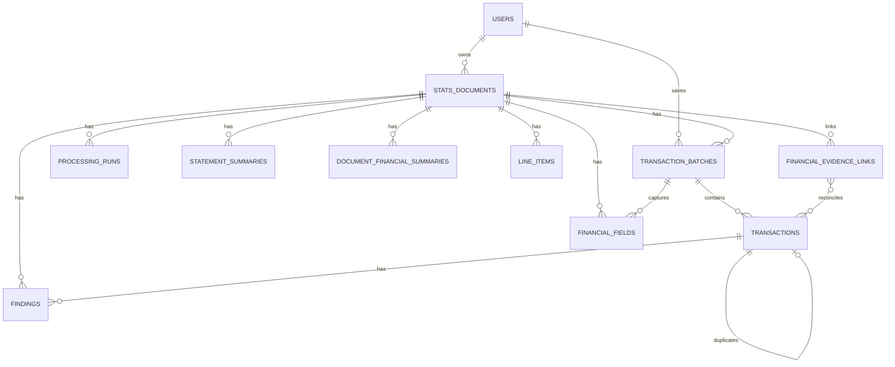

<!-- M9 - Stats Data and Persistence Start -->
<!-- Plans the Stats-owned database schema, persistence boundaries, and stored data model. -->

# Module 9 Stats Data and Persistence Module Specification

## Module Summary

Module 9 establishes the Stats-owned database and persistence layer.

M9 stores product data produced by the reusable processing modules: document intake metadata, processing run summaries, normalized transaction records, validation results, duplicate-check outcomes, and user ownership links. It is also the durable source of data for the future Stats dashboard and reporting modules. It does not perform OCR, extraction, validation, dashboard rendering, or identity authentication.

Earlier modules may still be incomplete while this spec is refined. The purpose of this draft is to define what the database must eventually remember so M3 through M8 can keep their contracts stable and M10/M11 can build on reliable stored records.

## Architecture Alignment

| Field | M9 Direction |
| --- | --- |
| Build order | `9` |
| Module | Stats Data and Persistence |
| Type | Encompassing product module |
| Main responsibility | Database schema, migrations, persistence adapters, duplicate checks against stored records, retrieval APIs |
| Owner folder | `apps/stats-data/` |
| Primary input | M8 `DataValidationResult` plus authenticated user context |
| Primary output | Saved document/workflow/transaction records and queryable data for review, dashboarding, and reporting |

## Goals

- Define the Stats product database schema separately from reusable processing modules.
- Store M8 normalized records only after the user chooses to save ready transactions.
- Preserve traceability from saved transactions back to validation, extraction, parse, and ingestion identifiers.
- Support database-backed duplicate checks before insert.
- Associate stored documents and transactions with the authenticated user who uploaded or saved them.
- Keep sensitive financial document data controlled and avoid persisting full OCR text unless explicitly justified later.
- Provide migrations and persistence adapters under `apps/stats-data/`.
- Keep runtime database configuration environment-driven and compatible with Azure SQL Database as the cloud operational store.
- Shape stored transaction and document data so later dashboard/reporting modules can query totals, trends, status counts, categories, sources, and review backlogs without rereading source files or rerunning processing modules.
- Preserve document-level financial facts for M11 to answer obligations, payments, reconciliation, credit exposure, and evidence-quality questions.

## Non-Goals

- Reimplementing M1 identity, password, token, or role logic.
- Reimplementing M3/M4 file validation or file storage behavior.
- Reimplementing M5 parsing, M7 extraction, or M8 validation rules.
- Rendering dashboards or report visualizations.
- Owning final dashboard UX, chart layout, or visual analytics decisions.
- Email mailbox polling or attachment retrieval.
- Production cloud database deployment.

## Data To Store

### Identity-Owned Data

M1 already owns identity account behavior. M9 may reference identity users by stable user ID, but it must not expose or duplicate password hashes, token material, first-login state, or identity internals.

Current identity table data remains behind the identity module contract:

| Data | Owner | M9 Use |
| --- | --- | --- |
| User ID | M1 | Foreign/reference key for ownership and audit fields |
| Email/full name/role | M1 | Display through identity API when needed |
| Password hash/token fields | M1 | Not used by M9 |

### M8 Result Staging

M9 should keep a staging/audit table for each M8 `DataValidationResult` received from Stats Web before records are promoted into dashboard-ready relational tables.

This staging table is recommended because M8 output includes nested arrays, evolving contract fields, review metadata, source references, and summary/evaluation data. Staging preserves the exact module result for troubleshooting, reprocessing, and contract-change safety while the normalized tables serve dashboard and reporting queries.

Recommended table:

| Table | Purpose |
| --- | --- |
| `m8_validation_results` | Exact M8 result envelope plus high-value indexed columns |

Important fields:

| Field | Purpose |
| --- | --- |
| `m8_validation_result_id` | Stats-owned staging row identifier |
| `validation_id` | M8 validation identifier, unique when present |
| `extraction_id` | M7 extraction identifier |
| `parse_id` | M5 parse identifier |
| `ingestion_id` | M3/M4 ingestion identifier from `document` |
| `uploaded_by_user_id` | User scope for the result |
| `document_type` | M8 document type |
| `status` | M8 validation status |
| `document_review_status` | M8 summary review status |
| `recommended_action` | M8 summary recommended action |
| `normalized_record_count` | M8 summary count |
| `valid_record_count` | M8 summary count |
| `warning_record_count` | M8 summary count |
| `invalid_record_count` | M8 summary count |
| `duplicate_record_count` | M8 summary count |
| `review_item_count` | M8 summary count |
| `debit_total` | M8 summary debit total |
| `credit_total` | M8 summary credit total |
| `net_total` | M8 summary net total |
| `reconciliation_delta` | M8 summary reconciliation difference |
| `payload_json` | Full M8 `DataValidationResult` JSON |
| `promotion_status` | Pending, promoted, partially promoted, rejected, failed |
| `promotion_error` | Controlled error details when promotion fails |
| `created_at_utc` | Staging insert time |
| `promoted_at_utc` | Promotion completion time |

M9 should not use this staging table as the main dashboard source. Dashboard/reporting queries should read from promoted tables such as `transactions`, `document_financial_summaries`, `line_items`, `findings`, and `financial_evidence_links`.

### Document Intake And Workflow Data

M9 should store a product-level document/workflow record for each file that reaches the save/review stage.

| Field | Purpose |
| --- | --- |
| `document_id` | Stats-owned stable document identifier |
| `ingestion_id` | Link to M3/M4 ingestion result |
| `uploaded_by_user_id` | User who submitted or owns the document |
| `original_filename` | User-recognizable source filename |
| `normalized_filename` | Stored/sanitized filename |
| `source_type` | Manual upload, email attachment, batch import, API |
| `source_id` | Optional upstream source identifier |
| `sha256` | File hash for duplicate/source matching |
| `detected_mime_type` | Accepted content type |
| `size_bytes` | File size |
| `storage_reference` | Local/cloud path or object key, not raw file bytes |
| `document_type` | M5/M7/M8 document classification label |
| `source_institution` | Bank, merchant, provider, biller, or counterparty when known |
| `status` | Current workflow status |
| `ocr_quality_status` | Good, partial, low, failed, or not applicable |
| `redaction_applied` | Whether sensitive snippets were masked before storage/display |
| `created_at_utc` | Record creation time |
| `updated_at_utc` | Last update time |

Recommended statuses:

- `uploaded`
- `parsed`
- `extracted`
- `validated`
- `ready_to_save`
- `saved`
- `needs_review`
- `failed`

### Processing Run Data

M9 should store lightweight run metadata for traceability and evidence without storing full sensitive OCR text.

| Field | Purpose |
| --- | --- |
| `processing_run_id` | Stats-owned run identifier |
| `document_id` | Parent document |
| `parse_id` | M5 parse identifier |
| `extraction_id` | M7 extraction identifier |
| `validation_id` | M8 validation identifier |
| `module_name` | Parsing, extraction, validation, persistence |
| `module_version` | Version when available |
| `status` | Completed, completed with warnings, failed |
| `started_at_utc` | Run start |
| `completed_at_utc` | Run completion |
| `summary_json` | Counts/totals/evaluation summary |
| `finding_counts_json` | Aggregated finding counts |

M9 should avoid storing full unredacted OCR text in this table. If later review workflows require source snippets, store redacted snippets or source references only.

### Validation Batch Data

M9 should store the M8 save attempt as a batch so the UI can show what was accepted, skipped, or needs review.

| Field | Purpose |
| --- | --- |
| `transaction_batch_id` | Save attempt identifier |
| `document_id` | Parent document |
| `validation_id` | M8 validation identifier |
| `saved_by_user_id` | User who confirmed saving |
| `status` | Saved, partially saved, rejected, needs review |
| `input_record_count` | Normalized records received |
| `saved_record_count` | Records inserted |
| `duplicate_record_count` | Records skipped as duplicates |
| `warning_record_count` | Records saved or held with warnings |
| `invalid_record_count` | Records rejected |
| `debit_total` | Batch debit total |
| `credit_total` | Batch credit total |
| `net_total` | Batch net total |
| `created_at_utc` | Save attempt time |

### Transaction Records

This is the core durable financial data M9 should store from M8 normalized records. These records should be dashboard-ready enough to support totals, trends, category summaries, debit/credit splits, source-document drilldowns, and review counts without requiring dashboard code to parse raw module JSON.

| Field | Purpose |
| --- | --- |
| `transaction_id` | Stats-owned stable transaction identifier |
| `transaction_batch_id` | Save batch |
| `document_id` | Source document |
| `source_candidate_id` | M7/M8 candidate link |
| `transaction_date` | Normalized transaction date |
| `posted_date` | Optional posted/settled date when statements provide both dates |
| `description` | Cleaned transaction description |
| `amount` | Positive absolute amount |
| `currency` | Currency code, default currently `PHP` |
| `direction` | Debit, credit, or unknown |
| `signed_amount` | Debit/credit signed value for reporting |
| `source_institution` | Bank, merchant, provider, or counterparty source |
| `merchant_or_counterparty` | Optional later normalized merchant/payee |
| `category` | Optional user/system category |
| `reference` | Optional transaction/reference code |
| `payment_method` | Card, bank transfer, EFTPOS, cash, unknown |
| `masked_account_or_card` | Masked account/card reference only |
| `confidence` | M8 record confidence |
| `quality_status` | Valid, warning, invalid, duplicate |
| `review_required` | Boolean flag for dashboard/review queues |
| `duplicate_of_transaction_id` | Link when database duplicate is detected |
| `source_page_number` | Optional source page |
| `source_line_number` | Optional source line |
| `source_text_redacted` | Optional short redacted source snippet |
| `created_at_utc` | Insert time |
| `updated_at_utc` | Last update time |

Dashboard-facing query dimensions:

- Transaction date by day, month, quarter, and year.
- Direction: debit, credit, unknown.
- Currency.
- Category.
- Merchant or counterparty.
- Source institution.
- Payment method.
- Masked account/card where available.
- Source type and document type.
- Quality status and review state.
- Uploaded/saved user scope.

Recommended first duplicate key:

```text
user_id + transaction_date + normalized_description + signed_amount + currency + direction
```

The hash should tolerate formatting differences by lowercasing descriptions, trimming whitespace, normalizing repeated spaces, and rounding amount comparison to the M8 tolerance.

### Financial Fields

M8 may produce document-level financial fields that are useful for review and reporting.

| Field | Purpose |
| --- | --- |
| `financial_field_id` | Stats-owned field identifier |
| `document_id` | Parent document |
| `transaction_batch_id` | Optional save batch |
| `field_name` | Field key such as total, merchant, due date |
| `value` | Normalized value |
| `currency` | Optional currency |
| `confidence` | Field confidence |
| `quality_status` | Valid/warning/invalid |
| `source_page_number` | Optional source page |
| `source_line_number` | Optional source line |
| `source_text_redacted` | Optional redacted evidence snippet |

### Statement Summaries And Obligations

Credit-card statements and bills contain dashboard-critical values that are not ordinary transaction rows. M9 should store these separately so M11 can show due dates, debt exposure, installment obligations, and payment urgency.

| Field | Purpose |
| --- | --- |
| `statement_summary_id` | Stable summary identifier |
| `document_id` | Parent statement/bill document |
| `statement_date` | Statement issue/date period marker |
| `period_start_date` | Optional statement period start |
| `period_end_date` | Optional statement period end |
| `payment_due_date` | Due date for card/bill payment |
| `minimum_amount_due` | Minimum payment due |
| `total_amount_due` | Total amount due |
| `previous_balance` | Previous balance |
| `payments_total` | Payments recorded in the statement |
| `purchases_total` | Purchases/charges total |
| `fees_total` | Fees total when present |
| `interest_total` | Interest total when present |
| `installment_balance` | Remaining installment exposure when present |
| `outstanding_balance` | Current outstanding balance |
| `credit_limit` | Credit limit when present |
| `available_credit` | Available credit when present |
| `currency` | Currency code |
| `confidence` | Confidence in the summary extraction/validation |
| `quality_status` | Valid, warning, needs review |

### Invoices, Receipts, And Line Items

Receipts and invoices need totals, paid/owing status, GST/tax, and item/service rows for useful reporting.

Recommended tables:

| Table | Purpose |
| --- | --- |
| `document_financial_summaries` | Invoice/receipt/payment-proof totals and normalized document-level amounts |
| `line_items` | Receipt/invoice/service item rows tied to a source document |

Important fields for `document_financial_summaries`:

| Field | Purpose |
| --- | --- |
| `document_financial_summary_id` | Stable summary identifier |
| `document_id` | Parent document |
| `invoice_number` | Invoice/document number when present |
| `issue_date` | Invoice/receipt issue date |
| `subtotal_amount` | Subtotal before tax when available |
| `tax_amount` | GST/tax amount |
| `total_amount` | Total due/paid amount |
| `paid_amount` | Paid amount |
| `owing_amount` | Remaining balance |
| `currency` | Currency code |
| `payment_status` | Paid, partially paid, unpaid, unknown |
| `confidence` | Summary confidence |
| `quality_status` | Valid, warning, needs review |

Important fields for `line_items`:

| Field | Purpose |
| --- | --- |
| `line_item_id` | Stable line item identifier |
| `document_id` | Parent document |
| `description` | Item/service description |
| `quantity` | Optional quantity |
| `unit_amount` | Optional unit price |
| `line_amount` | Line total |
| `tax_amount` | Optional line tax |
| `category` | Optional category |
| `confidence` | Line extraction confidence |
| `source_page_number` | Optional source page |
| `source_line_number` | Optional source line |
| `source_text_redacted` | Optional redacted snippet |

### Payment Proof And Reconciliation

The M11 planning thread identified payment proofs, EFTPOS slips, invoices, receipts, and card statements that may represent the same financial event from different evidence. M9 needs a reconciliation model so the dashboard can show matched, unmatched, and duplicate-looking items.

Recommended table:

| Table | Purpose |
| --- | --- |
| `financial_evidence_links` | Links documents/transactions that appear to prove or describe the same payment/obligation |

Important fields:

| Field | Purpose |
| --- | --- |
| `financial_evidence_link_id` | Stable link identifier |
| `source_document_id` | Source evidence document |
| `target_document_id` | Related evidence document, if document-to-document |
| `source_transaction_id` | Source transaction, if transaction-level |
| `target_transaction_id` | Related transaction, if transaction-level |
| `link_type` | Invoice paid by proof, receipt paid by EFTPOS, statement contains transaction, possible duplicate, related evidence |
| `match_status` | Suggested, confirmed, rejected |
| `match_confidence` | Confidence score |
| `match_reason` | Controlled explanation for UI/review |
| `reference` | Confirmation, approval, RRN, invoice, or masked reference when present |
| `created_at_utc` | Link creation time |
| `updated_at_utc` | Link update time |

### Findings And Review Items

M9 should preserve actionable findings without forcing every module-specific code into transaction columns.

| Field | Purpose |
| --- | --- |
| `finding_id` | Stable finding identifier |
| `document_id` | Parent document |
| `transaction_id` | Optional affected transaction |
| `processing_run_id` | Optional affected run |
| `source_module` | M3, M5, M7, M8, M9 |
| `code` | Finding code |
| `severity` | Info, warning, error |
| `message` | Controlled human-readable summary |
| `status` | Open, resolved, ignored |
| `created_at_utc` | Finding creation time |
| `resolved_at_utc` | Resolution time |
| `resolved_by_user_id` | User who resolved it |

## Draft Entity Relationship

The detailed draft ERD, including the current M1 `users` table, lives at:

```text
docs/M9-stats-data-erd.md
```



## First Schema Draft

Recommended table names:

| Table | Purpose |
| --- | --- |
| `stats_documents` | Product document/workflow records |
| `processing_runs` | Module run traceability summaries |
| `transaction_batches` | User-confirmed save attempts |
| `transactions` | Durable normalized financial transactions |
| `financial_fields` | Document-level fields and extracted totals |
| `statement_summaries` | Credit-card/bill statement obligations and exposure |
| `document_financial_summaries` | Invoice, receipt, and payment-proof totals |
| `line_items` | Receipt/invoice/service line items |
| `financial_evidence_links` | Suggested or confirmed matches between proofs, invoices, receipts, statements, and transactions |
| `findings` | Actionable findings and review items |

M9 may later add:

- `transaction_categories`
- `merchant_aliases`
- `accounts`
- `budgets`
- `report_snapshots`
- `audit_events`
- `dashboard_metric_snapshots`

Those should wait until review/reporting requirements are clearer.

## Dashboard Data Source Requirements

M9 is the source of truth for the future dashboard. Dashboard and reporting modules should read from M9 tables or M9 query APIs rather than calling M3 through M8 directly.

The first database design should support these dashboard needs:

| Dashboard Need | M9 Data Source |
| --- | --- |
| Total spending/income over time | `transactions.transaction_date`, `direction`, `signed_amount`, `currency` |
| Monthly debit/credit/net trends | `transactions` grouped by date period and currency |
| Category breakdown | `transactions.category` |
| Merchant/payee summaries | `transactions.merchant_or_counterparty` and normalized description |
| Recent transactions | `transactions` ordered by transaction date and created time |
| Upcoming obligations | `statement_summaries.payment_due_date`, `minimum_amount_due`, `total_amount_due`, `document_financial_summaries.owing_amount` |
| Credit exposure | `statement_summaries.outstanding_balance`, `credit_limit`, `installment_balance` |
| Invoice/payment matching | `financial_evidence_links`, `document_financial_summaries.payment_status`, transaction references |
| Receipt/invoice detail | `document_financial_summaries` and `line_items` |
| Documents processed | `stats_documents.status`, `document_type`, `source_type`, timestamps |
| Save/review backlog | `transaction_batches`, `findings`, `quality_status` |
| Duplicate and skipped counts | `transaction_batches` and duplicate links on `transactions` |
| Processing health summaries | `processing_runs.status`, `finding_counts_json`, timestamps |

The dashboard should not need raw uploaded files, full OCR text, or raw module debug JSON for normal charts. If a chart needs derived values, M9 should either expose a query/read model or store a controlled summary/snapshot after the underlying transactions are saved.

## M11-Driven Planning Considerations

The M11 dashboard planning thread used representative fixtures: card statements, pharmacy/medical receipts, a lab invoice, an EFTPOS slip, and bank transfer proof. Those samples mean M9 should plan for these financial questions, not only generic spending totals:

- What do I owe soon?
- What did I already pay?
- Which invoices or bills are unmatched?
- Which payment proofs match invoices, receipts, statement rows, or transfers?
- How much credit-card debt, limit usage, and installment exposure exists?
- Which documents and transactions need human review before dashboard numbers can be trusted?
- Can each dashboard number trace back to a document, page/line, and redacted evidence snippet?

The M9 schema should therefore keep:

- Statement fields: statement date, due date, minimum due, total due, outstanding balance, credit limit, previous balance, payments, purchases, installment balance.
- Invoice/receipt fields: invoice number, subtotal, GST/tax, total, paid amount, owing amount, line items.
- Payment evidence fields: confirmation number, approval code, RRN/reference, masked source/destination account or card, payment channel/method.
- Quality fields: OCR quality, extraction/validation confidence, review-required flag, finding codes, duplicate status, redaction status.
- Traceability fields: document ID, ingestion ID, parse ID, extraction ID, validation ID, source filename, page/line, redacted source snippet.

## Persistence Flow

1. Stats Web receives M8 `DataValidationResult`.
2. User reviews the transaction checkpoint.
3. User clicks save ready transactions.
4. Stats Web sends the validation result plus authenticated user context to M9.
5. M9 validates ownership and required identifiers.
6. M9 creates or updates the `stats_documents` row.
7. M9 stores processing run summaries and findings.
8. M9 checks normalized records against existing stored transactions.
9. M9 inserts non-duplicate valid records into `transactions`.
10. M9 marks duplicate or invalid records as skipped/review items.
11. M9 returns a save summary to Stats Web.

## Azure SQL Implementation Changes

Because the cloud-first target is Azure SQL Database, M9 must replace PostgreSQL-specific assumptions with an Azure SQL-compatible persistence boundary.

Current runtime bootstrap flow:

1. `start-stats-runtime.sh` verifies `DATABASE_PROVIDER=AzureSql`.
2. The runtime waits for Azure SQL connectivity through `AZURE_SQL_CONNECTIONSTRING`.
3. The runtime applies M9 migrations from `apps/stats-data/migrations/azure-sql/` using `apps/stats-data/scripts/apply_azure_sql_migrations.py`.
4. The runtime initializes M1 identity tables.
5. The runtime starts the module APIs and Stats Web only after database bootstrap completes.

The migration runner must not print connection strings, passwords, or secret values. It may print migration filenames and non-secret status messages.

Required implementation changes:

| Area | Change |
| --- | --- |
| Runtime configuration | Prefer `AZURE_SQL_CONNECTIONSTRING` and `DATABASE_PROVIDER=AzureSql`; keep `DATABASE_URL` only as a temporary compatibility setting. |
| Python database driver | Replace PostgreSQL-only `psycopg` paths with an Azure SQL-compatible driver path such as `mssql-python` or SQLAlchemy over `mssql+pyodbc`. |
| Container image | Install any required SQL Server driver dependencies when using ODBC, or choose `mssql-python` if it fits the ORM/access pattern without system ODBC setup. |
| M1 identity persistence | Move current `users` table creation/migration under the Stats Data migration boundary or make M1 database initialization provider-aware for Azure SQL. |
| Migrations | Add M9-owned migrations for Azure SQL types, indexes, constraints, and default schema `dbo`. Avoid PostgreSQL-only syntax. |
| Startup readiness | Replace `stats-db`/PostgreSQL socket readiness in cloud startup with an Azure SQL connectivity check. |
| Local Compose | Treat `stats-db` PostgreSQL as local legacy wiring only, or replace it with Azure SQL Edge / Azure SQL dev database if local parity becomes more important than lightweight local setup. |
| Tests | Update integration and evidence checks that currently assert `stats-db`, `psql`, PostgreSQL volume names, or PostgreSQL connection URLs. |
| Secrets | Store Azure SQL connection strings or managed-identity settings through Azure Container Apps secrets / Key Vault; never commit real values. |
| Cloud identity | Prefer Microsoft Entra / managed identity authentication for Azure SQL where practical. |

Schema design changes:

- Use `uniqueidentifier` or `nvarchar(36)` consistently for IDs. The current M1 `users.id` is `String(36)`, so M9 can safely reference it as `nvarchar(36)` unless a later migration converts IDs to native `uniqueidentifier`.
- Use `datetime2` or `datetimeoffset` for UTC timestamps.
- Use `decimal(19,4)` for money-like values instead of floating point.
- Use `nvarchar` for user-visible text.
- Use Azure SQL JSON support for `payload_json`, `summary_json`, and `finding_counts_json`.
- Use filtered/ordinary indexes for dashboard filters: user, document status, transaction date, currency, category, quality status, and review status.

Cloud-first deployment order:

1. Create Azure SQL logical server/database.
2. Enable Microsoft Entra admin and decide managed identity versus temporary SQL credential.
3. Add cloud secret/config values for `AZURE_SQL_CONNECTIONSTRING` and `DATABASE_PROVIDER=AzureSql`.
4. Add Azure SQL driver/dependency support to the runtime image.
5. Make M1 identity DB initialization/provider behavior Azure SQL-compatible.
6. Add M9 migrations and run them against Azure SQL.
7. Update startup readiness checks.
8. Update integration/evidence tests from PostgreSQL checks to Azure SQL checks.

## API Contract Draft

| Endpoint | Method | Purpose |
| --- | --- | --- |
| `/health` | `GET` | Service/database readiness |
| `/api/v1/transactions/batches` | `POST` | Save M8 normalized records |
| `/api/v1/documents` | `GET` | List stored documents for current user/admin scope |
| `/api/v1/documents/{document_id}` | `GET` | Retrieve document workflow summary |
| `/api/v1/transactions` | `GET` | Query saved transactions |
| `/api/v1/transactions/{transaction_id}` | `PATCH` | Update category/review fields |
| `/api/v1/dashboard/summary` | `GET` | Return dashboard totals, trends, obligation, reconciliation, and review summaries |
| `/api/v1/statements` | `GET` | Query statement obligations and credit exposure |
| `/api/v1/document-financial-summaries` | `GET` | Query invoice, receipt, and payment-proof totals |
| `/api/v1/reconciliation-links` | `GET` | Query matched/unmatched financial evidence links |
| `/api/v1/findings` | `GET` | List open review findings |
| `/api/v1/findings/{finding_id}` | `PATCH` | Resolve or ignore a finding |

## Configuration

| Setting | Suggested Default | Purpose |
| --- | --- | --- |
| `AZURE_SQL_CONNECTIONSTRING` | Azure SQL connection string or managed-identity connection string | Primary cloud database connection |
| `DATABASE_PROVIDER` | `AzureSql` | Selects Azure SQL provider behavior instead of legacy PostgreSQL behavior |
| `DATABASE_SCHEMA` | `dbo` | Default Azure SQL schema unless later separated |
| `DATABASE_URL` | Legacy/local compatibility only | Temporary setting for modules not yet migrated from PostgreSQL-style configuration |
| `ENABLE_DATABASE_DUPLICATE_CHECKS` | `true` | Compare M8 records to stored transactions |
| `DUPLICATE_MATCH_AMOUNT_TOLERANCE` | `0.01` | Amount comparison tolerance |
| `STORE_SOURCE_TEXT_SNIPPETS` | `false` | Avoid storing sensitive OCR snippets by default |
| `MAX_TRANSACTION_BATCH_SIZE` | `1000` | Save request guardrail |

## Security And Data Governance

- Store file references, hashes, metadata, summaries, and normalized records; do not store raw uploaded file bytes in relational tables.
- Keep full source documents in configured storage paths or future object storage.
- Avoid storing full OCR text by default.
- Redact source snippets if snippets are needed for review.
- Use authenticated user context for all save/query routes.
- Scope ordinary users to their own documents and transactions.
- Allow administrator visibility only through explicit admin routes or role checks.
- Never expose identity secrets, password hashes, tokens, or database credentials through M9 responses.

## Testing Boundary

From M13 onward, official M9 verification should run through the Stats container runtime.

| Test Type | Required Coverage |
| --- | --- |
| Unit tests | Duplicate-key generation, persistence mapping, validation-result mapping |
| API tests | Save batch, query documents, query transactions, duplicate save behavior |
| Integration tests | Azure SQL schema creation/migration and cloud database connectivity |
| Regression tests | M1 identity still works; M8 checkpoint can call M9 save path |
| Evidence tests | Browser save flow and database verification screenshots/output |

## Acceptance Criteria

- M9 spec exists before persistence implementation grows.
- `apps/stats-data/` owns schema, migrations, persistence adapters, and query layer.
- M9 can save M8 normalized records with traceability to ingestion, parse, extraction, and validation IDs.
- M9 performs database-backed duplicate checks before inserting transactions.
- M9 associates stored records with authenticated users.
- M9 stores dashboard-ready statement, invoice, receipt, payment-proof, and reconciliation facts when M7/M8 provide them.
- M9 exposes or can derive query results for M11 dashboard summaries, trends, obligations, reconciliation status, review backlog, and processing health.
- M9 returns a save summary with saved, skipped duplicate, warning, and invalid counts.
- M9 avoids storing raw document bytes or full unredacted OCR text in relational tables.
- M9 migrations can create the Stats-owned tables in Azure SQL.
- Container-first tests verify database wiring, save behavior, and prior-module regression.

<!-- M9 End -->
