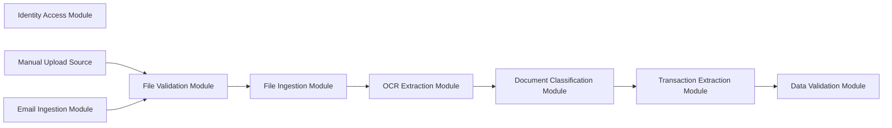

# Stats Building-Block Module Input/Output Map

## Purpose

This document defines the inputs and outputs for the reusable Stats building-block modules.

It excludes encompassing or product-specific layers:

- Stats `.NET` front end and dashboard.
- Database implementation, persistence adapters, and storage schema because these belong to the encompassing Stats product layer.
- Project foundation, evaluation evidence, cloud readiness, and containerization.

The goal is to make each reusable module understandable and testable on its own before Stats composes them into a complete workflow.

## Flow Overview

## Reusable Module Contracts

| Module | Primary Input | Primary Output | Output Used By |
| --- | --- | --- | --- |
| Identity Access Module | Login credentials, token validation request, role/permission check request | Auth token/session result, user identity claims, authorization decision, auth error | Any module or UI needing protected access |
| File Validation Module | Uploaded file or file reference plus validation policy | Accepted/rejected file validation result, detected file metadata, rejection reasons, optional hash | File Ingestion Module |
| File Ingestion Module | Validated file metadata, source context, accepted file reference/content | Ingestion job/request record, ingestion status, normalized document handoff | OCR Extraction Module and workflow coordinator |
| OCR Extraction Module | Ingested document reference/content and OCR/extraction options | Extracted text, page/image metadata, extraction method, confidence/quality metadata, extraction errors | Document Classification Module and later extraction modules |
| Document Classification Module | Extracted text and document metadata | Document type label, confidence, classification reasons/features where useful, unknown result | Transaction Extraction Module and workflow coordinator |
| Transaction Extraction Module | Extracted text, document type, document metadata, extraction rules/options | Transaction candidates and financial field candidates with source/confidence metadata | Data Validation Module |
| Data Validation Module | Transaction candidates, document context, data-quality rules/options | Cleaned/normalized records, validation warnings/errors, duplicate flags, completeness/quality report | Stats workflow, reporting, and Stats persistence layer |
| Email Ingestion Module | Authorized mailbox/source config, email search/fetch request | Attachment candidates, email source metadata, ingestion-ready file handoff, email intake status/errors | File Validation Module or File Ingestion Module |

## Detailed Input/Output Definitions

### Identity Access Module

**Input**

| Input Item | Description |
| --- | --- |
| Credentials | Email/username and password for login. |
| Token | Existing bearer/session token for verification. |
| Access Check | User claims plus requested action/resource/role. |

**Output**

| Output Item | Description |
| --- | --- |
| Auth Result | Success/failure result for login or token verification. |
| User Claims | User identifier, role, permissions, active status. |
| Token Result | Token/session material and expiry metadata where applicable. |
| Authorization Decision | Allowed/denied decision with reason/code. |

**Minimum test fixtures**

- Valid admin credentials.
- Valid standard-user credentials.
- Invalid credentials.
- Missing/expired/invalid token.
- Role-required action denied for standard user.

### File Validation Module

**Input**

| Input Item | Description |
| --- | --- |
| File Content or File Reference | Candidate document entering the system. |
| Source Metadata | Filename, content type, source, size if known. |
| Validation Policy | Allowed types, allowed extensions, maximum size, required signature rules. |

**Output**

| Output Item | Description |
| --- | --- |
| Validation Status | Accepted or rejected. |
| File Metadata | Normalized filename, size, extension, detected type, content type, optional hash. |
| Validation Findings | Error/warning codes such as unsupported type, empty file, oversize file, signature mismatch. |

**Minimum test fixtures**

- Valid PDF.
- Missing/empty file.
- Oversized file.
- Extension/content mismatch.
- Unsupported file type.

### File Ingestion Module

**Input**

| Input Item | Description |
| --- | --- |
| Validated File | File content/reference that passed validation. |
| Source Context | Manual upload, email attachment, batch import, API source, user/source identifier. |
| Ingestion Options | Target workflow, idempotency/deduplication hints, processing priority if supported. |

**Output**

| Output Item | Description |
| --- | --- |
| Ingestion ID | Stable identifier for the document intake attempt. |
| Ingestion Status | Received, queued, rejected, handed off, failed. |
| Normalized Document Handoff | Document reference/content and metadata for downstream processing. |
| Ingestion Findings | Duplicate-source warning, source failure, unsupported workflow, handoff error. |

**Minimum test fixtures**

- Valid manual upload handoff.
- Valid email attachment handoff.
- Duplicate/idempotent submission.
- Downstream handoff failure.

### OCR Extraction Module

**Input**

| Input Item | Description |
| --- | --- |
| Document Content or Reference | PDF/image/scanned document accepted for processing. |
| Document Metadata | Filename, page/image details if known, detected media type, source. |
| Extraction Options | Direct text allowed, OCR fallback allowed, language/options, timeout limits. |

**Output**

| Output Item | Description |
| --- | --- |
| Extracted Text | Text extracted from the document. |
| Extraction Metadata | Page count, extraction method, OCR engine, processing time. |
| Quality Metadata | Confidence or quality indicators where available. |
| Extraction Findings | No text, unreadable file, OCR timeout, unsupported document/image condition. |

**Minimum test fixtures**

- Text PDF.
- Scanned/image PDF.
- Low-quality or blank document.
- Unsupported/corrupt document.

### Document Classification Module

**Input**

| Input Item | Description |
| --- | --- |
| Extracted Text | Text from OCR/direct extraction. |
| Document Metadata | Filename/source/type hints/page metadata. |
| Classification Options | Supported document classes and thresholds. |

**Output**

| Output Item | Description |
| --- | --- |
| Document Type | Bank statement, receipt, invoice, utility bill, or unknown. |
| Confidence | Classification confidence or certainty level. |
| Classification Findings | Reasons/features, ambiguous result, unsupported class result. |

**Minimum test fixtures**

- Bank statement text.
- Receipt text.
- Invoice text.
- Utility bill text.
- Unknown/ambiguous financial text.

### Transaction Extraction Module

**Input**

| Input Item | Description |
| --- | --- |
| Extracted Text | Text from OCR Extraction Module. |
| Document Type | Type result from Document Classification Module. |
| Document Metadata | Source, page reference, filename, extraction metadata. |
| Extraction Options | Field rules/templates/model settings where supported. |

**Output**

| Output Item | Description |
| --- | --- |
| Transaction Candidates | Candidate records with date, amount, description, debit/credit where found. |
| Financial Field Candidates | Merchant/biller, category, reference, totals, bill due details where found. |
| Source Metadata | Text span/page/line/source context where available. |
| Extraction Findings | Missing field, uncertain parse, ambiguous amount/date, unsupported layout. |

**Minimum test fixtures**

- Bank statement transaction rows.
- Receipt purchase data.
- Invoice/bill amount data.
- Ambiguous date/amount text.
- Text with no transaction fields.

### Data Validation Module

**Input**

| Input Item | Description |
| --- | --- |
| Candidate Records | Transaction/field candidates from extraction. |
| Document Context | Document type, source, extraction quality, metadata. |
| Data-Quality Rules | Normalization, required fields, duplicate rules, confidence thresholds. |

**Output**

| Output Item | Description |
| --- | --- |
| Normalized Records | Cleaned dates, amounts, labels, categories, record structure. |
| Validation Report | Passed/warned/failed results by record and batch. |
| Findings | Missing field, invalid field, duplicate flag, low confidence, incomplete record. |
| Quality Summary | Counts and completeness/quality indicators for evaluation. |

**Minimum test fixtures**

- Clean transaction candidates.
- Missing date/amount.
- Duplicate candidates.
- Low-confidence input.
- Invalid number/date formats.

### Email Ingestion Module

**Input**

| Input Item | Description |
| --- | --- |
| Mailbox Authorization Context | Authorized account/token/connection profile. |
| Retrieval Request | Time range, sender/filter rules, attachment rules, mailbox/folder. |
| Intake Policy | Allowed attachment types, deduplication behavior, polling/manual trigger. |

**Output**

| Output Item | Description |
| --- | --- |
| Attachment Candidates | File content/reference plus attachment metadata. |
| Email Source Metadata | Email ID, sender, subject, received time, attachment name. |
| Intake Status | Retrieved, skipped, duplicate, failed. |
| Intake Findings | Unauthorized mailbox, no attachment, unsupported attachment, retrieval error. |

**Minimum test fixtures**

- Authorized email with PDF attachment.
- Email with no attachment.
- Unsupported attachment.
- Duplicate attachment/email ID.
- Unauthorized/expired mailbox context.

## Suggested Contract Families

| Contract Family | Used For |
| --- | --- |
| Identity Contract | User claims, token verification, authorization result. |
| File Candidate Contract | File content/reference and source metadata before processing. |
| File Validation Result Contract | Accepted/rejected file and validation findings. |
| Ingestion Handoff Contract | Ingestion ID, normalized document metadata, downstream handoff. |
| Text Extraction Result Contract | Extracted text and OCR/extraction metadata. |
| Document Classification Result Contract | Document type and confidence. |
| Transaction Candidate Contract | Parsed transaction/financial field candidates before cleaning. |
| Data Quality Result Contract | Clean records plus warnings/errors/quality summary. |

## End-to-End Handoff Sequence

| Step | Producer | Output | Consumer |
| --- | --- | --- | --- |
| 1 | Manual upload source or Email Ingestion Module | File candidate | File Validation Module |
| 2 | File Validation Module | Accepted file validation result | File Ingestion Module |
| 3 | File Ingestion Module | Normalized document handoff | OCR Extraction Module |
| 4 | OCR Extraction Module | Text extraction result | Document Classification Module |
| 5 | Document Classification Module | Classification result plus text context | Transaction Extraction Module |
| 6 | Transaction Extraction Module | Transaction candidates | Data Validation Module |
| 7 | Data Validation Module | Cleaned records and quality report | Stats workflow, Stats reporting, and Stats persistence layer |

## Boundary Notes

- The front end may call Identity Access Module and File Ingestion Module, but it should not implement their reusable rules.
- Stats data persistence receives results after reusable processing, but the database/persistence layer is not part of this reusable input/output map.
- Module contracts should be stable enough that another project can replace Stats Web and still use these modules.
- For each module chat, treat the rows above as the starting contract. Refine fields only when that module spec needs them.
