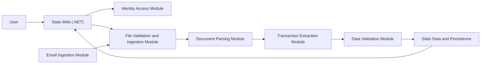

# Stats Building-Block Module Plan

## Architecture Direction

Stats will be developed as an integrating product built from reusable modules.

- The Stats front end and Stats database are encompassing product modules that present the user experience, persist project data, and coordinate backend capabilities.
- Backend capabilities are segregated into standalone modules that can be tested, containerized, versioned, and reused in other projects.
- A reusable module should not depend on Stats UI code or Stats-specific page flows.
- Reusable modules communicate through explicit APIs, contracts, files, queues, or events rather than importing each other's internal code.
- Each module gets its own spec, folder, README, tests, evidence, configuration sample, and container path when containerization is reached.

<!-- M0 Foundation Start -->
<!-- Defines the project-wide configuration boundary for every later building block. -->
- Runtime values must be supplied through config files or supported environment/secret providers instead of being hardcoded in source code.
- Committed configuration must contain only safe defaults or examples; real secrets and local developer overrides stay uncommitted.
<!-- M0 Foundation End -->

## Proposed Repository Segregation

```text
000_Capstone/
|-- apps/
|   |-- stats-web/                    # .NET encompassing front end and Stats orchestration
|   |-- stats-data/                   # Stats database schema, migrations, persistence adapters
|   `-- stats-admin-tools/            # Optional scripts/tools used only by Stats
|-- modules/
|   |-- identity-access-module/          # Login, tokens, roles, access checks
|   |-- file-validation-module/          # File validation plus upload intake, source tracking, ingestion jobs
|   |-- document-parsing-module/         # OCR/direct text extraction plus document classification
|   |-- transaction-extraction-module/   # Financial field/transaction extraction
|   |-- data-validation-module/          # Cleaning, duplicate checks, data-quality warnings
|   `-- email-ingestion-module/          # Email attachment intake into ingestion flow
|-- contracts/
|   |-- identity/
|   |-- documents/
|   |-- extraction/
|   `-- transactions/
|-- infrastructure/
|   |-- compose/
|   |-- containers/
|   `-- cloud/
|-- docs/
|   |-- module-plans/
|   |-- specs/
|   `-- evidence/
|-- samples/
|   |-- synthetic/
|   `-- anonymized/
`-- tests/
    `-- integration/                  # Cross-module Stats workflow tests
```

## Module Standards

Every standalone module must provide:

1. A module spec with goals, non-goals, tasks, and acceptance criteria.
2. A local run command and test command.
3. A clear input/output contract.
4. Module-local automated tests.
5. Evidence for its acceptance tests.
6. A configuration example with no secrets committed.
7. A Dockerfile or container plan before cloud deployment.
8. Failure behavior that is visible to callers through explicit errors or status results.
9. Config-driven real-data tests and evidence when a module processes user-like files, records, extracted text, transactions, emails, or stored workflow artefacts.

<!-- M0 Foundation Start -->
<!-- Requires modules to keep runtime configuration outside source literals. -->
9. Config-defined runtime values for environment-dependent URLs, hosts, ports, database targets, secrets, tokens, file paths, feature switches, and cloud resource settings.
<!-- M0 Foundation End -->

## Module Map

| Build Order | Module | Type | Main Responsibility | Reusable Contract |
| --- | --- | --- | --- | --- |
| 0 | Project Foundation | Project | Repo conventions, module specs, GitHub workflow, evidence standard | Module template and repo rules |
| 1 | Identity Access Module | Standalone module | User login, role claims, tokens, protected access checks | Auth/token API and token verification contract |
| 2 | Stats Web Shell | Encompassing `.NET` app | Login UI, app navigation, service orchestration shell | Calls module APIs; no OCR/parsing logic |
| 3-4 | File Validation and Ingestion Module | Standalone module | Validate file type, size, extension, signatures, hashes, rejection reasons, accepted-file intake, ingestion records, and handoff status | File validation request/result API plus ingestion API/status contract |
| 5 | Document Parsing Module | Standalone module | Extract text from PDFs/images/scans, classify document type, expose parse quality/evaluation metadata | Document parsing API/result contract |
| 6 | Merged into M5 | Retired standalone slot | Former document classification scope is now part of M5 | Covered by M5 classification result |
| 7 | Transaction Extraction Module | Standalone module | Extract financial fields and transaction candidates | Transaction extraction API/result contract |
| 8 | Data Validation Module | Standalone module | Clean, validate, warn, and detect duplicates/incomplete records | Data-quality report contract |
| 9 | Stats Data and Persistence | Encompassing product module | Stats database schema, migrations, persistence adapters, stored workflow results | Stats persistence contract |
| 10 | Stats Workflow Integration | Stats product | Connect web upload to file intake, OCR, classification, extraction, data validation, and persistence | End-to-end Stats workflow |
| 11 | Stats Dashboard and Reporting | Encompassing `.NET` app | Financial dashboard, document status, transactions, summaries, warnings | UI over Stats persistence/query layer |
| 12 | Email Ingestion Module | Standalone module | Retrieve authorized attachments and submit them to file intake | Email source adapter and intake contract |
| 13 | Containerization | Infrastructure | Local containers, Compose, service health checks, dependencies | Dockerfiles and Compose profiles |
| 14 | Cloud Readiness | Infrastructure | Azure config, secrets, storage, monitoring, deployment notes | Deployment and environment contract |
| 15 | Evaluation Evidence | Project | Metrics, ground-truth comparisons, report evidence | Evaluation dataset/results format |

## Stats Composition View



## BA Alignment

| Business Analysis Area | Building-Block Plan |
| --- | --- |
| User Management and Access Control | Identity Access Module plus Stats Web login/access UI |
| Manual Document Upload | Stats Web upload UI plus the merged File Validation and Ingestion Module |
| File validation controls | Merged File Validation and Ingestion Module |
| OCR Processing | Merged Document Parsing Module |
| Process and Data Analysis | M5 classification output, Transaction Extraction, Data Validation |
| Data Storage | Stats Data and Persistence product module |
| Dashboard and Reporting | Stats Web dashboard/reporting module |
| Email Ingestion | Email Ingestion Module feeding the merged File Validation and Ingestion Module |
| Validation and Evaluation | Evaluation Evidence module and per-module tests |
| Cloud architecture | Containerization and Cloud Readiness modules |

## Timeline Mapping

The official Capstone timeline remains six weeks. The reusable-module architecture changes the grouping, not the deadline.

| Dates | Delivery Focus | Building-Block Modules |
| --- | --- | --- |
| 20-26 May 2026 | Project setup and detailed design | Foundation, Identity Access spec, Stats Web shell direction, sample/contracts setup |
| 27 May-2 June 2026 | Document ingestion | Merged File Validation and Ingestion Module, Stats upload workflow contract |
| 3-9 June 2026 | OCR and parsing | Merged Document Parsing Module, Transaction Extraction Module |
| 10-16 June 2026 | Validation, cleaning, and storage | Data Validation Module, Stats Data and Persistence |
| 17-23 June 2026 | Dashboard and integration | Stats Workflow Integration, Stats Dashboard and Reporting |
| 24-30 June 2026 | Testing and finalisation | Containerization priority pass, Cloud Readiness notes, Evaluation Evidence, final fixes |

## Boundary Decisions

### Stats Web

`apps/stats-web/` owns:

- `.NET` front end.
- Login and access screens.
- Upload screens.
- Dashboard and reporting screens.
- Calling reusable module APIs.
- Stats-specific navigation and presentation.

`apps/stats-web/` does not own:

- Password hashing/token issuance internals.
- File validation rules implementation.
- OCR engines.
- Document parsing rules.
- Data-quality algorithms.

### Stats Data and Persistence

`apps/stats-data/` owns the Stats-specific database direction:

- Database schema and migrations.
- Persistence adapters for document workflow results.
- Queries used by Stats Web dashboard and reporting.
- Associations between users, ingested documents, extraction results, validation results, and reporting records.

Stats Data and Persistence is not a reusable standalone processing module. It stores the outputs of reusable modules in the form required by the Stats product. Another project may reuse the processing modules with a different schema and storage strategy.

### Identity Access Module

`modules/identity-access-module/` owns authentication and authorization primitives. Other projects should be able to reuse it with a different UI.

### File Validation and File Ingestion

These are implemented in one reusable intake runtime:

- File validation answers whether a file is acceptable and why.
- File ingestion tracks accepted files entering a workflow and exposes downstream handoff/status.

### Document Parsing and Financial Extraction

M5 merges OCR/text extraction and document classification into one reusable parsing runtime:

- Document Parsing Module chooses direct PDF text or OCR, returns text, parse metadata, quality/evaluation fields, redacted evidence preview, and classification result.
- Transaction Extraction Module interprets financial fields from text/document context.

## Suggested Per-Module Chat Prompt

```text
We are implementing only <module name> as a standalone reusable module/building block for the Stats project.
Use docs/building-block-module-plan.md as the architecture boundary.
First create the module spec, tasks, contracts, acceptance criteria, and test plan.
Do not add Stats-specific UI or logic unless this module is apps/stats-web.
```
