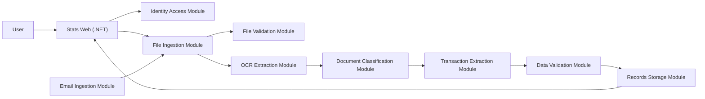

# Stats Building-Block Module Plan

## Architecture Direction

Stats will be developed as an integrating product built from reusable modules.

- The Stats front end is an encompassing `.NET` module that presents the user experience and coordinates backend capabilities.
- Backend capabilities are segregated into standalone modules that can be tested, containerized, versioned, and reused in other projects.
- A reusable module should not depend on Stats UI code or Stats-specific page flows.
- Reusable modules communicate through explicit APIs, contracts, files, queues, or events rather than importing each other's internal code.
- Each module gets its own spec, folder, README, tests, evidence, configuration sample, and container path when containerization is reached.

## Proposed Repository Segregation

```text
000_Capstone/
|-- apps/
|   |-- stats-web/                    # .NET encompassing front end and Stats orchestration
|   `-- stats-admin-tools/            # Optional scripts/tools used only by Stats
|-- modules/
|   |-- identity-access-module/          # Login, tokens, roles, access checks
|   |-- file-validation-module/          # File rules, signatures, size/type checks, hashes
|   |-- file-ingestion-module/           # Upload intake, source tracking, ingestion jobs
|   |-- ocr-extraction-module/           # OCR/text extraction from supported documents
|   |-- document-classification-module/  # Document type classification
|   |-- transaction-extraction-module/   # Financial field/transaction extraction
|   |-- data-validation-module/          # Cleaning, duplicate checks, data-quality warnings
|   |-- records-storage-module/          # Persist and retrieve processed document records
|   `-- email-ingestion-module/          # Email attachment intake into ingestion flow
|-- contracts/
|   |-- identity/
|   |-- documents/
|   |-- extraction/
|   `-- transactions/
|-- infrastructure/
|   |-- compose/
|   |-- containers/
|   `-- cloud/
|-- docs/
|   |-- module-plans/
|   |-- specs/
|   `-- evidence/
|-- samples/
|   |-- synthetic/
|   `-- anonymized/
`-- tests/
    `-- integration/                  # Cross-module Stats workflow tests
```

## Module Standards

Every standalone module must provide:

1. A module spec with goals, non-goals, tasks, and acceptance criteria.
2. A local run command and test command.
3. A clear input/output contract.
4. Module-local automated tests.
5. Evidence for its acceptance tests.
6. A configuration example with no secrets committed.
7. A Dockerfile or container plan before cloud deployment.
8. Failure behavior that is visible to callers through explicit errors or status results.

## Module Map

| Build Order | Module | Type | Main Responsibility | Reusable Contract |
| --- | --- | --- | --- | --- |
| 0 | Project Foundation | Project | Repo conventions, module specs, GitHub workflow, evidence standard | Module template and repo rules |
| 1 | Identity Access Module | Standalone module | User login, role claims, tokens, protected access checks | Auth/token API and token verification contract |
| 2 | Stats Web Shell | Encompassing `.NET` app | Login UI, app navigation, service orchestration shell | Calls module APIs; no OCR/parsing logic |
| 3 | File Validation Module | Standalone module | Validate file type, size, extension, signatures, hashes, rejection reasons | File validation request/result API |
| 4 | File Ingestion Module | Standalone module | Receive files from upload/source adapters, create ingestion record/job | Ingestion API and ingestion status contract |
| 5 | OCR Extraction Module | Standalone module | Extract text from PDFs/images/scans, expose extraction metadata | Text extraction API/result contract |
| 6 | Document Classification Module | Standalone module | Classify bank statement, receipt, invoice, bill, unknown | Classification API/result contract |
| 7 | Transaction Extraction Module | Standalone module | Extract financial fields and transaction candidates | Transaction extraction API/result contract |
| 8 | Data Validation Module | Standalone module | Clean, validate, warn, and detect duplicates/incomplete records | Data-quality report contract |
| 9 | Records Storage Module | Standalone module | Persist documents, extracted text, structured records, processing results | Storage/query API |
| 10 | Stats Workflow Integration | Stats app | Connect web upload to validation, ingestion, OCR, classification, extraction, validation, storage | End-to-end Stats workflow |
| 11 | Stats Dashboard and Reporting | Encompassing `.NET` app | Financial dashboard, document status, transactions, summaries, warnings | UI over storage/query APIs |
| 12 | Email Ingestion Module | Standalone module | Retrieve authorized attachments and submit them to file ingestion | Email source adapter and ingestion contract |
| 13 | Containerization | Infrastructure | Local containers, Compose, service health checks, dependencies | Dockerfiles and Compose profiles |
| 14 | Cloud Readiness | Infrastructure | Azure config, secrets, storage, monitoring, deployment notes | Deployment and environment contract |
| 15 | Evaluation Evidence | Project | Metrics, ground-truth comparisons, report evidence | Evaluation dataset/results format |

## Stats Composition View



## BA Alignment

| Business Analysis Area | Building-Block Plan |
| --- | --- |
| User Management and Access Control | Identity Access Module plus Stats Web login/access UI |
| Manual Document Upload | Stats Web upload UI plus File Ingestion Module |
| File validation controls | File Validation Module |
| OCR Processing | OCR Extraction Module |
| Process and Data Analysis | Classification, Transaction Extraction, Data Validation |
| Data Storage | Records Storage Module |
| Dashboard and Reporting | Stats Web dashboard/reporting module |
| Email Ingestion | Email Ingestion Module |
| Validation and Evaluation | Evaluation Evidence module and per-module tests |
| Cloud architecture | Containerization and Cloud Readiness modules |

## Timeline Mapping

The official Capstone timeline remains six weeks. The reusable-module architecture changes the grouping, not the deadline.

| Dates | Delivery Focus | Building-Block Modules |
| --- | --- | --- |
| 20-26 May 2026 | Project setup and detailed design | Foundation, Identity Access spec, Stats Web shell direction, sample/contracts setup |
| 27 May-2 June 2026 | Document ingestion | File Validation Module, File Ingestion Module, Stats upload workflow contract |
| 3-9 June 2026 | OCR and parsing | OCR Extraction Module, Document Classification Module, Transaction Extraction Module |
| 10-16 June 2026 | Validation, cleaning, and storage | Data Validation Module, Records Storage Module |
| 17-23 June 2026 | Dashboard and integration | Stats Workflow Integration, Stats Dashboard and Reporting |
| 24-30 June 2026 | Testing and finalisation | Containerization priority pass, Cloud Readiness notes, Evaluation Evidence, final fixes |

## Boundary Decisions

### Stats Web

`apps/stats-web/` owns:

- `.NET` front end.
- Login and access screens.
- Upload screens.
- Dashboard and reporting screens.
- Calling reusable module APIs.
- Stats-specific navigation and presentation.

`apps/stats-web/` does not own:

- Password hashing/token issuance internals.
- File validation rules implementation.
- OCR engines.
- Document parsing rules.
- Data-quality algorithms.

### Identity Access Module

`modules/identity-access-module/` owns authentication and authorization primitives. Other projects should be able to reuse it with a different UI.

### File Validation and File Ingestion

These remain separate:

- File Validation Module answers whether a file is acceptable and why.
- File Ingestion Module tracks a file entering a workflow and calls validation/extraction modules as needed.

### OCR and Financial Extraction

These remain separate:

- OCR Extraction Module turns a supported document into text and extraction metadata.
- Document Classification Module identifies the document class.
- Transaction Extraction Module interprets financial fields from text/document context.

## Suggested Per-Module Chat Prompt

```text
We are implementing only <module name> as a standalone reusable module/building block for the Stats project.
Use docs/building-block-module-plan.md as the architecture boundary.
First create the module spec, tasks, contracts, acceptance criteria, and test plan.
Do not add Stats-specific UI or logic unless this module is apps/stats-web.
```
