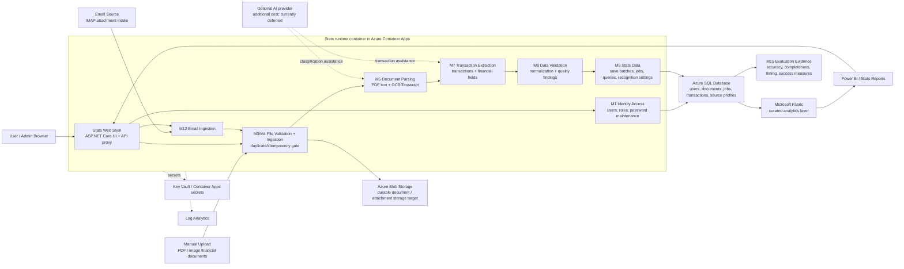

<!-- Stats Overall Schematic Start -->

# Stats App Overall Schematic

Use this page-friendly image for Word documents:

## Diagram Summary

The Stats app is built as a container-first system. Users enter through the Stats Web shell, then manual uploads and email attachments flow through reusable processing modules: validation/intake, document parsing/OCR, transaction extraction, data validation, and Stats Data persistence. Azure SQL is the operational store, Blob Storage is the durable file target, Key Vault/App Secrets protect sensitive configuration, Log Analytics supports runtime evidence, and Fabric/Power BI sit downstream for analytics and reporting.

## Mermaid Source

<!-- Stats Overall Schematic End -->
