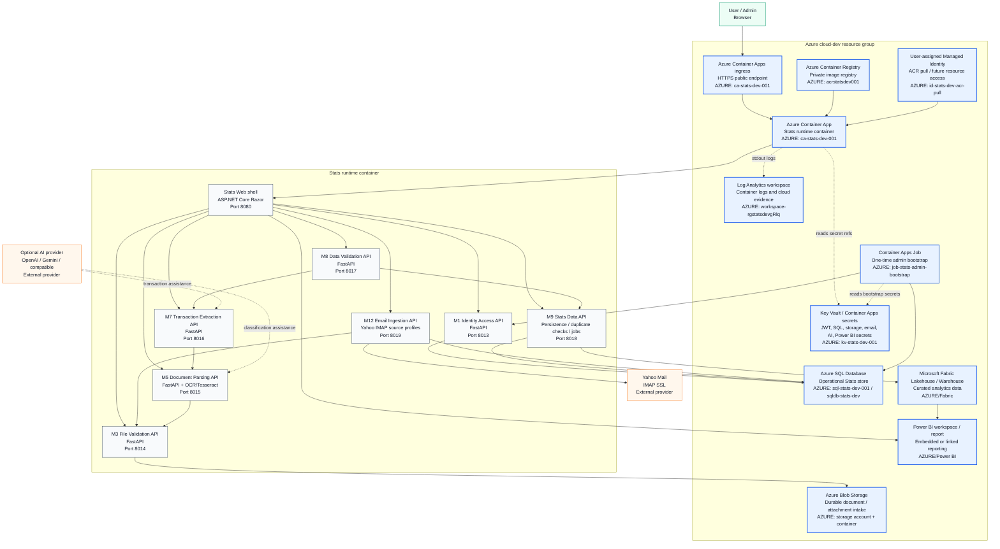

<!-- Stats System Design Start -->

# Stats System Design With Azure Resources

This diagram shows the current Stats application design as a container-first system, with Azure resources explicitly marked. The cloud-dev runtime hosts the Stats Web shell and module APIs inside one Stats runtime container; shared persistence, files, secrets, logs, and reporting integrations are externalized to Azure services.

## Word-Ready Image

Use this cleaned image with official Azure service icons for MS Word pages and presentation/report artefacts:

Additional exports:

- `docs/assets/stats-system-design-azure-word-icons.png`
- `docs/assets/stats-system-design-azure-word-icons.jpg`
- `docs/assets/stats-system-design-azure-word-clean.png`
- `docs/assets/stats-system-design-azure-word-clean.jpg`
- `docs/assets/stats-system-design-azure-word.png`
- `docs/assets/stats-system-design-azure-word.jpg`

## Detailed Mermaid Source

## Azure Resources Included

| Azure resource | Current Stats role |
| --- | --- |
| Azure Container Registry `acrstatsdev001` | Stores the private `stats-runtime` container image. |
| Azure Container Apps environment `cae-stats-dev-001` | Managed environment for the Stats Container App. |
| Azure Container App `ca-stats-dev-001` | Hosts Stats Web and all module APIs inside the single runtime container. |
| Azure SQL server `sql-stats-dev-001` | Logical SQL host for cloud operational persistence. |
| Azure SQL database `sqldb-stats-dev` | Stores users, documents, validation results, processing jobs, transactions, source profiles, and M12 email-ingestion settings. |
| Azure Blob Storage | Durable document and attachment intake target when `STATS_STORAGE_PROVIDER=AzureBlobStorage`. |
| Azure Key Vault `kv-stats-dev-001` / Container Apps secrets | Stores secret values and secret references for SQL, JWT, admin bootstrap, storage, email, AI, and Power BI credentials. |
| User-assigned managed identity `id-stats-dev-acr-pull` | Supports ACR image pull and future managed access to cloud resources. |
| Log Analytics workspace `workspace-rgstatsdevgRlq` | Collects Container Apps logs and supports cloud evidence review. |
| Container Apps Job `job-stats-admin-bootstrap` | Runs the one-time first-admin bootstrap flow against Azure SQL. |
| Microsoft Fabric workspace / Lakehouse | Planned/optional curated analytics layer fed from Stats operational data. |
| Power BI workspace / report | Planned/optional dashboard and reporting surface for curated Stats data. |

## Main Flows

1. Browser traffic enters through Azure Container Apps ingress and reaches Stats Web on port `8080`.
2. Stats Web calls module APIs through same-container internal proxy targets.
3. File upload and email attachment paths converge at M3 File Validation, then continue through parsing, extraction, validation, and Stats Data persistence.
4. Azure SQL is the central operational database for identity, processing jobs, document metadata, extracted/validated data, and email ingestion configuration.
5. Azure Blob Storage is the durable file store for accepted documents and attachments when cloud storage is enabled.
6. Secret values stay outside code and normal API responses through Key Vault, Container Apps secrets, and encrypted M12 secret storage.
7. Fabric and Power BI sit downstream of the operational store for analytics and reporting.

<!-- Stats System Design End -->
